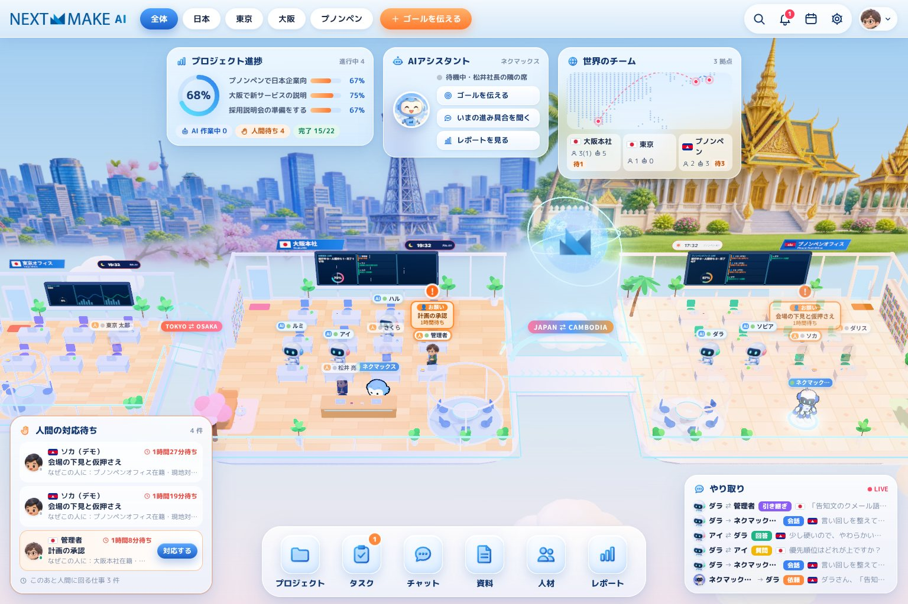

# NEXTMAKE AI COMPANY ― AI社員と人間が一緒に働く 3D バーチャルオフィス

人間が**ゴール**を伝えると、統括 AI の**ネクマックス**（裏側は Claude Code）が仕事を分解し、
足りない職種は **AI社員を「採用」** し、**人間にしかできない仕事は人間へ**振り分けます。
AI社員どうしの相談・引き継ぎは、three.js の**かわいい 3D オフィス**（🇯🇵 東京オフィス・大阪本社 × 🇰🇭 プノンペンオフィス）で、
人が歩き、会議室に集まり、吹き出しと光の粒が行き交う様子として見えます。3 つの拠点は 1 つの画面に並んでいて、一元的に状況を確認できます。
複数人が同時にログインして同じ状況を見られます。

大阪本社の社長席では、**松井社長とネクマックスが隣どうし**に座っています。ネクマックスは社長の分身として、社長の方針と過去の判断（社長の記憶）を踏まえて仕事を分け、配ります。



画面のデザインは [`docs/img/design_reference.jpg`](docs/img/design_reference.jpg)（参考イメージ）に合わせています。ロゴは NEXTMAKE 公式サイトの画像（`client/public/brand/`）です。

```
人間「プノンペンで IT 人材の交流イベントを開きたい」
  └─ ネクマックス（Claude Code）がタスクに分解
       ├─ 足りない職種 → イベントプランナー・クメール語翻訳・広報ライターを採用（入口から登場して席へ）
       ├─ AI の仕事   → AI社員 1 人 = Claude Code の 1 セッション（作業フォルダにファイルを書く・同僚に相談する）
       └─ 人間の仕事  → 会場の下見（現地）・予算の承認（責任）→ 担当者の「マイタスク」へ
  └─ 終わるたびに、担当者ごとのコンテキスト（記憶）がたまり、次の仕事のプロンプトに入る
  └─ 全部終わったら完了報告
```

## 動かす

```bash
cd ai-company
npm install
npm run dev          # サーバー（:8787）と画面（:5173）を同時に起動 → http://localhost:5173
```

最初の起動で、管理者とデモの人間のアカウントが作られ、ターミナルと `data/credentials.txt` に出ます。

| 環境変数 | 意味 |
|---|---|
| `AI_ENGINE=claude` | Claude Code（Claude Agent SDK）で本当に動かす。未指定なら画面右上で管理者が切り替え（初期値はシミュレーション） |
| `AI_ENGINE=sim` | Claude を呼ばないシミュレーション（デモ・画面の確認用。同じ流れを通る） |
| `AI_MODEL` | Claude のモデル（省略時は Claude Code の既定） |
| `MAX_PARALLEL_AGENTS` | 同時に作業する AI社員の数（既定 3） |
| `TASK_BUDGET_USD` | 1 タスクあたりの上限（既定 1.5 USD） |
| `AGENT_ALLOW_BASH=1` | AI社員にシェル（Bash）を許可する（既定は ファイル読み書き・Web 検索だけ） |
| `ADMIN_LOGIN` / `ADMIN_PASSWORD` / `ADMIN_NAME` | 管理者の初期アカウント |
| `CEO_NAME` / `CEO_LOGIN` | 社長（既定：松井 亮 / matsui）。ネクマックスの隣の席 |
| `TOKYO_NAME` / `TOKYO_LOGIN` | 東京オフィスの 1 人（既定：東京メンバー（仮）/ tokyo）。あとから画面のプロフィールの「編集」で名前を変えられます |
| `SEED_DEMO=0` | デモの人間（さくら・ソカ・ダリス）を作らない |
| `PORT` / `DATA_DIR` / `WORKSPACE_DIR` | ポート・状態の保存先・AI社員の作業フォルダ |
| `HOST` | 待ち受けるアドレス（既定 `127.0.0.1` = その PC の中だけ。外へは Cloudflare Tunnel などを通す） |
| `NODE_ENV=production` | 本番。デモの人間を作らない（`SEED_DEMO=1` で作る） |
| `TRUST_PROXY=1` / `COOKIE_SECURE=1` / `ALLOWED_ORIGINS` | HTTPS の入口（Tunnel など）の裏で動かすとき |
| `AGENT_WEB=0` | AI社員に Web の検索・取得を使わせない |

**動かし方（無料・サブスクの範囲）とセキュリティは [`docs/deploy.md`](docs/deploy.md)** にまとめています。
1 人のサブスクのログインで、同僚の分までサーバーが AI を動かすことは規約上できません。複数人で使うなら、次のどちらかにしてください。

- **claude.ai のアーティファクト版**（`npm run build:artifact`）：入力は全員、実行は承認する人 1 人のページ
- **会社の API キー**

### 承認の関所（Claude を動かす前の確認）

ほかの人が出したゴールや AI への話しかけは、**承認する人（既定は社長）が「始める」を押してから**動きます。

- 承認待ちは、承認する人の「人間の対応待ち」カードの先頭と、プロジェクトの「承認」の段に出ます。「始める」「見送る（理由つき）」を 1 タップで押せます。
- 出した人には「◯◯さんの承認待ち」と出ます。見送られたら理由が届きます。
- 右上の設定で「自動承認」にもできます（既定は手動）。
  - 対象の人と、1 日の上限（既定 5 件）を決められます。
  - アーティファクト版では、承認する人のページが開いていて見えている間だけ動きます。
- 中止できるのは、出した人・承認する人・管理者だけです。

Claude Code モードは、`claude` にログイン済み（または `ANTHROPIC_API_KEY` を設定済み）の環境で動きます。
本番：`npm run build && npm start`（http://localhost:8787）。

### みんなで見る（複数人ログイン）

サーバー 1 台に全員がブラウザでつなぎます。Claude Code モードは、`claude` にログイン済みのマシン（社内 PC や小さな VM）で
`npm run build && npm start` し、社内ネットワーク・Tailscale・Cloudflare Tunnel などで共有するのが手軽です。
HTTPS の裏で動かすときは `COOKIE_SECURE=1` を付けてください。ログイン中の人は右上と 3D の名札に出ます。

### Claude Code で通しで動かした例

ゴール「説明会の冒頭で使う、日本語とクメール語の短いあいさつ文を用意する」（約 5 分）：

1. ネクマックスが 6 タスクに分解し、「日クメール バイリンガル広報ライター」のソピアをプノンペンに採用
2. 「説明会の前提情報の確認」は、学校とやり取りしている現地マネージャー（人間）へ（理由：現地での関係づくりと直接の連絡が必要）
3. ソピアが日本語案 → クメール語版 → 読み上げ用 HTML を作成（`greeting_ja.md`・`greeting_km.md`・`greeting_final.html`）。途中で、人間の確認メモに修正点が書かれていないことに気づき、ネクマックスに質問
4. 「クメール語の自然さと文化面の確認」は母語話者の人間へ、最終承認は管理者へ
5. 完了報告は「人間の確認の中身が記録に残っていないので、まだ本番では使えない」と正直に指摘し、次の一手を並べた

## しくみ

| 場所 | 中身 |
|---|---|
| `server/company.ts` | 司令塔：分解 → 採用 → 割り振り → 依存関係の順に着手 → 記憶 → 完了報告 |
| `server/engine/claude.ts` | Claude Agent SDK：分解（JSON スキーマで構造化出力）、AI社員の作業（`claude_code` プリセット＋人物設定＋記憶、社内ツール `ask_colleague`・`post_update` を SDK の MCP で提供、`tools` で道具を限定、`permissionMode: dontAsk`、予算上限）、同僚への相談、完了報告 |
| `server/engine/sim.ts` | オフラインのシミュレーション |
| `server/memory.ts` | 人物ごとの記憶。新しさ（72 時間で半減）＋重要度で選んでプロンプトへ（Generative Agents の記憶の流れを簡略化） |
| `server/index.ts` | REST・WebSocket・ログイン（scrypt・HttpOnly クッキー） |
| `shared/types.ts` | サーバーと画面の共通の型 |
| `client/src/main.ts`・`ui/` | 画面：ゴール・タスクボード・マイタスク・社員と記憶・ログ |
| `client/src/world/` | 3D のバーチャルオフィス（日本・カンボジア・データの橋・ちびキャラ社員・ネクマックス）。設計は [`docs/space.md`](docs/space.md)、単体の確認ページは `client/world-preview.html` |
| `docs/research.md` | AI社員の作り方の調査メモ（出典つき） |
| `tests/` | 司令塔の流れのテスト（シミュレーションで通す）。`npm test` |

### 画面の見方（人間が把握したいことから決めた配置）

| 場所 | 何が分かるか |
|---|---|
| 上のバー | 表示の切り替え（全体・日本・東京・大阪・プノンペン）、**ゴールを伝える**、検索、お知らせ（自分へのお願い・質問の数）、今日のタイムライン、設定（頭脳の切り替え・人間の登録） |
| プロジェクト進捗 | 進行中のプロジェクト全体の完了率（輪）と、プロジェクトごとの進み具合。バーの色で「AI が進めている（青）／人間待ちで止まっている（オレンジ）／分解中（紫）」が分かる |
| AIアシスタント | ネクマックスがいま何をしているか。ゴールを伝える・進み具合を聞く・レポートを見る |
| 世界のチーム | 3 拠点の地図と、拠点ごとの人間・AI社員・オンライン・人間待ちの数。拠点をまたぐやり取りが起きると線が光る |
| 左下：人間の対応待ち | **いま AI が人間を待っている仕事**を、待たせている時間の長い順に。誰に・何を・なぜその人に（拠点・スキル・これまでの仕事）お願いしたかまで出す。自分の分は「対応する」ですぐ完了にできる |
| 右下：やり取り | 社員どうしの最新のやり取り（依頼・質問・回答・引き継ぎ・報告・採用） |
| ドック | **プロジェクト**（ゴールの入力、段階：分解→採用・割り振り→AI が作業→人間の確認→完了、依存関係の順に並べたタスクの流れ、成果物、完了報告）／**タスク**（かんばん：前の作業待ち・AI 作業中・人間の対応待ち・完了。自分・人間・AI・拠点で絞り込み）／**チャット**（全体のやり取り、相手を選んで話しかける、AI社員からの質問に返事）／**資料**（AI社員が作ったファイル）／**人材**（拠点ごとの名簿、採用履歴、人間の登録）／**レポート**（完了数、AI と人間の分担、人間の平均対応時間、拠点別・人別の実績、完了報告） |
| ドックの右：マイク | **話す**を押して、思いついたことをどんどん話す。ひと息ごとに「やることストック」へ入る（下の「話してストック」） |
| 3D | 人をクリックするとプロフィール（たまっていく記憶・話しかける・編集）。奥の壁のモニターに、その拠点のいまの仕事が出る。**ピンチイン・ピンチアウト**（スマホは 2 本指、トラックパッドはつまむ、マウスは Ctrl＋ホイール）で寄る・引く。カードの上でつまんでも、ページではなく 3D が拡大・縮小する |

人間へのお願いは、3D でも目立たせています：ネクマックスがオレンジのカードを持って席まで歩いて渡し、その人の頭の上に「！」、足元に輪、机の上に「◯分待ち」の札が出ます。

`?no3d` を付けて開くと、3D を作らずに画面だけで使えます（古い端末向け）。

### 話してストック（マイク → やることストック）

言いたいことは、整理しないまま話して大丈夫です。確認の手間を減らすことを優先して作っています。

1. ドックの右の **話す**（スマホは右下の丸いボタン）を押して、思いついたことを続けて話す。止めるまで聞き続ける
2. ひと息ごとにストックへ入り、**ネクマックスが整理する**
   - 1 つの発言に用件が 2 つあれば分ける（「あと」「それから」など）
   - 短い見出しを付ける
   - 種類に分ける：AI に任せる仕事／自分でやること／覚えておくこと
   - 急ぎを上にする（「今日」「明日まで」など）
   - 前に言ったことと同じ用件ならまとめる
3. **やることストック**（マイクの上の「ストック」）では、カードごとにボタンは 1 つだけ
   - **ネクマックスに任せる**：ゴールとして渡し、分解と採用が始まる
   - **やった**
   - **記憶に残す**：自分の記憶に入り、次からの仕事のプロンプトに使われる
4. 迷うものは「あとで」か「×」にする
   - どれもトーストの「元に戻す」で取り消せる
   - 話したままの文は、折りたたんだ「話した言葉」に残る
   - 「任せる」カードが 2 枚以上あれば、「全部任せる」でまとめて渡せる

| 項目 | 内容 |
|---|---|
| 認識する言葉 | 日本語・クメール語・英語（パネルで切り替え） |
| 使えるブラウザ | Chrome・Edge・Safari。Firefox は未対応で、文字で入力する |
| 声の行き先 | ブラウザの音声認識サービス（Chrome なら Google）に送られて文字になる。このアプリのサーバーには、文字になった後の文だけが届く |
| 見える人 | ストックは本人にしか見えない。「任せる」を押して初めて、みんなのプロジェクトになる |

### 記憶（コンテキスト）のたまり方

| いつ | 何が残るか | 重要度 |
|---|---|---|
| AI社員がタスクを終えた | 成果の要約と、本人が書いた「次に活かす学び」（`---MEMORY---` の後ろ） | 6 |
| 人間がタスクを完了にした | 完了メモ | 7 |
| 人間が AI社員の質問に返事した | 返事（質問した AI社員の記憶） | 8 |
| 誰かがカードから「記憶に足す」 | フィードバック | 8 |
| AI どうし・人間との相談 | 相談の要点（両方の記憶） | 3〜5 |
| 仕事の記憶が 3 件たまるごと | ふりかえり（Claude が 2〜3 行の気づきにまとめる） | 8 |

プロンプトには、重要度＋新しさ（72 時間で半減）の点数が高い 12 件を、古い順に入れます。

### 人間にしかできない仕事

ネクマックスは、対面・現地での行動、電話や訪問での関係づくり、契約・署名、支払いや発注の最終承認、法的責任を伴う判断、
最終の意思決定、実物の確認を「人間の仕事」にし、理由（`humanReason`）を添えて、拠点・スキル・これまでの仕事が合う人に渡します。
人間が「対応して完了にする」と書いたメモは、その人の記憶になり、続きの AI社員の入力にもなります。

### ネクマックス

[tomy1031/nexmax_chronicle](https://github.com/tomy1031/nexmax_chronicle) の手続きモデル（コードで組んだ 3D のネクマックス）を流用しています。
大阪本社には初号機（社長の隣の席）、プノンペンには量産型（NX-086）がいて、それぞれの拠点の仕事を配って回ります。東京オフィスの仕事は大阪の初号機が配ります。
