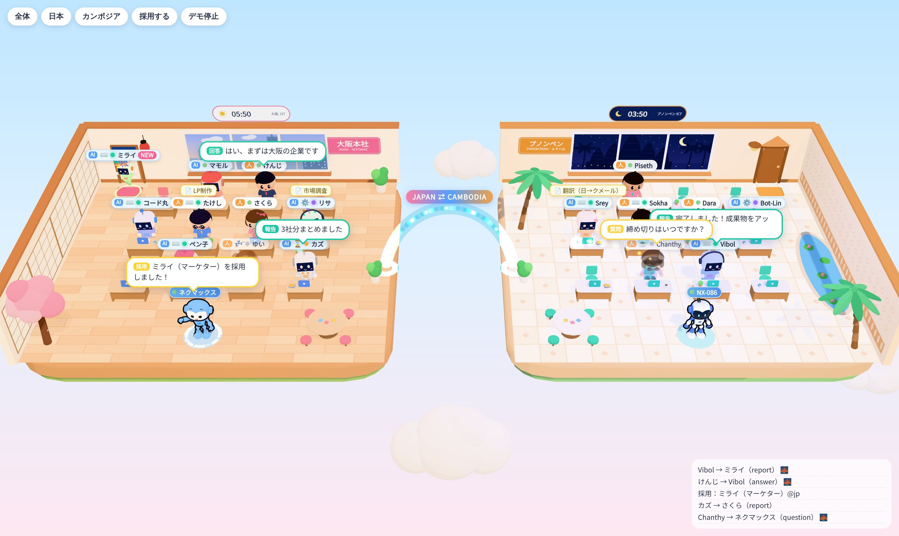
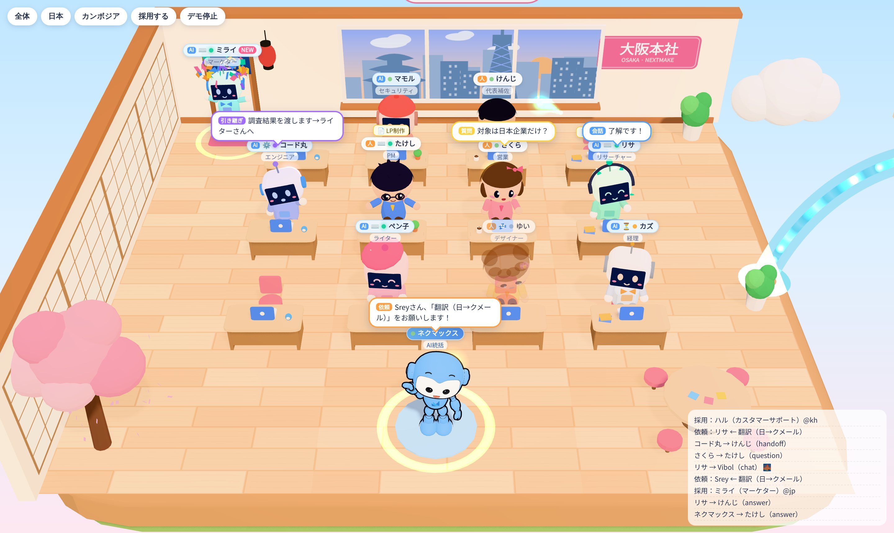

# バーチャルオフィス（3D 空間）

`client/src/world/` の `OfficeWorld` が、日本（大阪本社）とカンボジア（プノンペン）の 2 つのオフィスを 1 画面で見せます。単体の確認ページは `client/world-preview.html` です（`npm run dev:client` のあと `/world-preview.html`）。仮の社員 18 人が動き、8 秒ごとに 1 人採用されます。

## 配置

- 2 つのオフィスは空に浮かぶ島のジオラマです。日本が左、カンボジアが右で、左右対称に作っています（`layout.ts`：オフィスの中は `(u, z)`。`u` は外の壁へ向かう向き、`z` はカメラ側が `+`）。
- あいだに **光の道**（JAPAN ⇄ CAMBODIA）がかかっています。オフィスをまたぐやり取りは、光の粒がこの道を渡ります。道の上にはいつも小さな光が行き来しています。
- 机は各オフィス 12 席（4 列 × 3 行）。`deskIndex` 0〜3 が真ん中の行、4〜7 が手前の行、8〜11 が奥の行です。13 席目からは手前の広場に立ちます。
- 奥の壁に窓（外の景色）・看板・入口のドアがあります。ドアは採用された人が出てくる場所です。浮かぶ時計がその街の時刻（JST / ICT）を出し、時間帯（明け方・昼・夕方・夜）で窓の空、部屋の明かり、ちょうちんやランプの色が変わります。
- 日本：木の床、障子の壁、のれん、ちょうちん、桜（花びらが舞う）、窓の外に城の屋根と格子の塔。
- カンボジア：タイルの床、クメールふうの模様の壁、ヤシ、蓮の池、窓の外にアンコールふうの 5 つの塔。
- ネクマックスは手前の丸い台が定位置です（日本 = 初号機、カンボジア = 量産型 NX-086）。

## キャラクター

- 人間（`kind: 'human'`）：2 頭身のちびキャラ。`look.skin` 肌、`look.hair` 髪の色、`look.body` 服、`look.accent` ネクタイなどの差し色。`look.style` 0〜7 で髪型（ボブ・ロング・つんつん・ポニーテール・おだんご・横流し・アホ毛・短髪）。
- AI社員（`kind: 'agent'`）：画面の顔のロボット。`look.body` ボディ、`look.accent` 目・胸のランプ・アンテナの玉。`look.style` で目（たまご形・にっこり・まる）と耳（まる・ねこ耳・うさぎのアンテナ・ヘッドホン）が変わります。
- `look.accessory`：`glasses` `headset` `cap` `ribbon` `beret` `flower` `bowtie`（人間・AI社員どちらにも付く）。
- ネクマックス（`kind: 'nexmax'`）：`tomy1031/nexmax_chronicle` のモデル（`nexmax/`）をそのまま使っています。`look.nexmaxVariant` が `protagonist` か `production`、`look.serial` が胸の製造番号です。
- 名札（DOM の文字）：「人」「AI」の印、状態の点、名前、役割。作業中の仕事があると上に黄色い札が出ます。遠くから見るときは役割を省き、さらに遠いと点だけになります。

## 動きの意味

| 状態 | 見え方 |
|---|---|
| idle 待機 | 座ってゆらゆら・まばたき |
| working 作業中 | ノートPCをタイピング、名札に ⌨️、AI はアンテナが速く点滅 |
| thinking 考え中 | あごに手・首をかしげる、名札の ⚙️ が回る、アンテナが紫 |
| talking 会話中 | 体がはずみ、口がぱくぱく、💬 |
| waiting 待ち | きょろきょろ、⏳、アンテナがオレンジに点滅 |
| away 離席 / offline オフライン | 半透明で灰色、目を閉じる（offline）、☕ / 💤 |

| 出来事（API） | 演出 |
|---|---|
| `message(from, to, kind, text)` | 送り手の吹き出し（種類の色）＋光の粒が弧を描いて受け手へ、受け手がぴょんと跳ねる。オフィスをまたぐと光の道を渡る |
| ネクマックスの `assign`（同じオフィス） | ネクマックスが机のすき間を歩いて相手の机の前まで行き、手を振って渡してから戻る |
| `message(from, null, …)` | 床に波紋が 2 重に広がる（全体への発表） |
| `hire(member)` | ドアが開き、紙吹雪、ぴょんと出てきて自分の席まで歩き、着いたらきらきら。名札に NEW（25 秒） |
| `celebrate(id)` | 2 回ジャンプ＋きらきら |
| `focus(…)` / `setSelected(id)` | カメラがなめらかに移動 / 足元に黄色い輪 |
| `setInsets({ left, right, top, bottom })` | 画面に重なるパネルの分だけ、見える長方形の中心に合わせて撮り直す |

光の粒の色：依頼 オレンジ、会話 青、質問 黄、回答 緑、引き継ぎ 紫、報告 青緑、レビュー ピンク、採用 金、お知らせ 灰（`fx.ts` の `KIND_COLOR`）。

## 調整の手がかり

- キャラの大きさ：`chibi.ts` の `CHIBI_SCALE`（机に対して 1.3 倍）、ネクマックスは `nexmaxAvatar.ts` の `NEXMAX_HEIGHT`。
- オフィスの間隔・広さ：`layout.ts` の `OFFICE_CENTER_X`・`HALF_W`・`HALF_D`。机の位置は `COLS`・`ROWS`、歩く道は `AISLES`。
- 色：オフィスごとの色は `offices.ts` の `THEMES`、窓の空は `textures.ts` の `SKY`。
- 時間帯の区切り：`textures.ts` の `phaseOfHour`。
- 名札の細かさ：`OfficeWorld.ts` の `ppu`（1 m が何 px か）のしきい値。
- 重さ：ちびキャラは関節ごとに部品を 1〜2 個のメッシュにまとめ（頂点色）、影を落とすのは胴と頭だけです。動かない家具は材質ごとに 1 つにまとめています。18 人で約 470 ドローコール（影の分を含む）。
