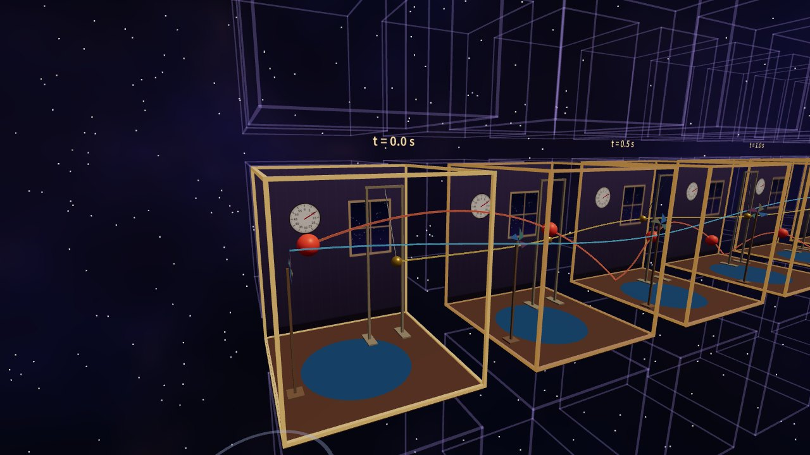

# ANAKATA — 5次元を 体で わかる VR

映画『インターステラー』の 5次元を、科学の 根拠に 沿って 体感する Meta Quest 向けの WebXR です（three.js r170 + WebXR、ビルド不要、**オフライン対応**）。PC・スマホの ブラウザでも 動きます。

物理学者キップ・ソーンの 説明では、映画の 5次元は **空間 4 ＋ 時間 1**。私たちの 宇宙（空間 3 ＋ 時間 1）は、その 中に うかぶ 膜（ブレーン）です。目に 見えない 次元は、**たとえ・切り口・影・重力・時間** の 5つの 道具で 体に しみこませる ことが できます。6つの 章で、4次元の 物体を 手で 回し、通りぬけさせ、最後は 時間が 歩ける 方向に なった 部屋に 入ります。

アナ（ana）と カタ（kata）は、4番目の 方向を 指す 言葉です（C. H. ヒントン, 1904）。上と 下、左と 右、前と 後ろの 次の 対。



## 遊び方（Meta Quest 3 / 3S）

1. Quest の ブラウザで **https://tomy1031.github.io/lab/anakata/** を 開き「VR ではじめる」。半径 1 m ほどの 空間を あけて 立ちます（座っても 遊べます）
2. 左に 浮かぶ **案内板** を レーザーで 指して **トリガー**。「つぎへ」で 説明が 進みます
3. 光る 玉（レバー）・つまみ・立体・月は、手を 近づけて **グリップ** で にぎります
4. **操作ガイド**（最初は ON）：両手の コントローラーの 上に「トリガー・グリップ・スティック・A/B/X/Y が この 章で 何を するか」の カードが 浮かび、案内板に「いま やること」、にぎる 物に 光る 輪が 出ます。**A か X** で 表示／非表示（案内板の「操作ガイド」ボタンでも）。設定は 次に 開いた ときも 残ります
5. **B か Y** で 目次。高さが 合わなければ 目次の「高さ・向きを 合わせる」。案内板は 何もない ところを にぎると 動かせます

一度 開けば、ネットが なくても 遊べます（Service Worker が 全ファイルを 保存）。

| 操作 | コントローラー（Quest 3 / 3S） | ハンドトラッキング | PC・スマホ |
|---|---|---|---|
| 案内板の ボタン | レーザーで 指して トリガー | 指先で 指して つまむ | クリック・タップ |
| にぎる（レバー・つまみ・立体・月） | 手を 近づけて グリップ（トリガーでも） | 近くで つまむ | ドラッグ |
| つまみを 回す | にぎって 手首を ひねる | つまんで ひねる | 円を 描くように ドラッグ／J L・I K・U O |
| W レバー（アナ／カタ） | にぎって 上下／左スティック 上下 | つまんで 上下 | ドラッグ／R F |
| 時間の 方向へ 進む（6章） | 左スティック 左右（右スティック 上下で 上・下）／何もない 所で グリップを にぎって 引く | 何もない 所で つまんで 引く | A D・ホイール（W S 前後・Q E 上下） |
| 操作ガイド | A または X | 案内板の ボタン | G・右上の ボタン |
| 目次 | B または Y | 案内板の ボタン | M |

## 6つの 章

| 章 | 体験 | たしかさ |
|---|---|---|
| 1 次元のはしご | 点 → 線 → 正方形 → 立方体 → 超立方体 → 5次元立方体。レバーを 引くと 図形が 新しい 方向へ 押し出され、新しい 辺が 跡を 描く。頂点・辺・面・胞の 数の 表（2^(n−k)·nCk） | 確かな数学 |
| 2 平面の国 | 腰の 高さの 2次元世界に、球・円すい・立方体・ドーナツを 手で 通す。住人に 見えるのは 切り口だけ。住人の 目に 映る **1次元の 像** も 表示。密室の 家から、壁を 壊さずに 金貨を 取り出す | 確かな数学 |
| 3 4次元の切り口 | こんどは 自分が 平面人。超球・超立方体・正五胞体・正十六胞体・正二十四胞体が 私たちの 空間を W 方向に 通りぬけ、切り口（3次元の 立体）だけが 見える。頂点から 通すと 正四面体 → 正八面体 → 正四面体。横に 1つ 下の 次元の 同じ 出来事 | 確かな数学 |
| 4 4次元の影 | 立方体の 影「正方形の 中の 正方形」と、超立方体の 影「立方体の 中の 立方体」を 並べ、同じ つまみで 光の 方へ 回す。1つの 胞を 追う、6つの 回転面、二重回転、5次元立方体の 影の 影 | 確かな数学 |
| 5 重力と余剰次元 | 月を 手で 投げて 太陽を 回らせる。3次元の 重力（1/r²）は 閉じた 安定な だ円、4次元（1/r³）は どう 投げても 落ちるか 逃げる、2次元（1/r）は 花びら。ブレーンと バルク（光は 膜の 中、重力は バルクへ）、余剰次元が 見つからない 理由（52 µm まで 1/r²） | 確かな科学・有力な仮説 |
| 6 テサラクト：時間を歩く | オリジナルの 小さな 部屋の 30 秒を、0.5 秒ごとに 61 部屋 並べて 時間の 中を 歩く。世界線（ボールは 波、振り子は 波、かざぐるまは らせん）。過去の 一瞬の ボールや 振り子を 押すと、その 先の 未来だけが 書きかわる | 確かな科学・推測（SF） |

説明には、ソーン『インターステラーの 科学』と 同じ 考え方で 印を 付けています：**確かな数学**・**確かな科学**・**有力な仮説**・**推測（SF）**。根拠と 文献は [docs/SCIENCE.md](docs/SCIENCE.md)。

## しくみ

| ファイル | 内容 |
|---|---|
| `js/math4.js` | n 次元の 回転（面の 中の 回転）、正多胞体（頂点・辺・胞）、4次元の 多胞体を 超平面で 切る（胞ごとの 多角形）、n → 3 の 遠近投影、W 座標の 色 |
| `js/chapters/*.js` | 6つの 章（`hub.js` は 最初の 空間）。各章は ステップごとの 説明・ボタン・操作ガイドを 持つ |
| `js/guide.js` | 操作ガイド：コントローラーの 上の カード、「いま やること」、にぎる 物の 光る 輪 |
| `js/input.js` | Quest の コントローラー（レーザー・直接 にぎる・スティック・ボタン）、ハンドトラッキング、マウス・タッチを 1つの しくみで |
| `js/widgets.js` | レバー・つまみ・物を 回す 持ち手 |
| `js/ui.js` | 案内板（VR では 浮かぶ 板、PC では 画面の 左下） |
| `js/tubes.js` | VR 用の 太い 線（インスタンス描画の 円柱）、切り口の 多角形 |
| `js/env.js` | 「バルク」の 空間（空・星・格子・足場） |
| `js/audio.js` | 音は すべて Web Audio で 合成（ファイルなし） |
| `sw.js` | オフライン用の Service Worker（公開時に `tools/bundle.mjs` が 版と ファイル一覧を 書き込む） |

- 切り口は 正確です：4次元の 凸多胞体の 各胞（3次元の 面）と 超平面 w = w₀ の 交わりを 多角形として 求め、外向きに 並べて 立体に します（`slice4`）。平面の国の 切り口は、各立体の 符号付き距離関数を シェーダーで 平面上に 評価しています
- 重力の 章の 力は a = −GM r̂ / r^(n−1)（n = 2, 3, 4）。どの 法則でも 半径 0.3 m の 円軌道の 速さが 同じに なるよう GM を 決め、速度ベルレ法で 積分
- テサラクトの 部屋は、30 秒の 歴史を 1/600 秒きざみで 一度に 計算（ボールの 跳ね返り・転がり、振り子 θ'' = −(g/L) sin θ − γθ'、L = 0.9 m で 周期 1.9 秒）。押すと その 時刻から 先を 計算し直し、変化が 未来へ 向かって 広がる 様子を 見せます

## 開発

```bash
cd anakata
npm i                  # テスト用（iwer：Meta の WebXR エミュレーター）
npm run serve          # http://127.0.0.1:8080/
npm test               # 数学・物理 → PC の 通し → VR（エミュレーター）→ オフライン
```

| テスト | 内容 |
|---|---|
| `tools/math.mjs` | n 次元立方体の 面の 数、正多胞体、切り口（胞から＝体積 8 の 立方体、頂点から＝四面体→切頂四面体→八面体）、回転の 直交性、二重回転、1/r² は 安定・1/r³ は 落ちる、押しても 過去は 変わらない、振り子の 周期 |
| `tools/smoke.mjs` | PC で 全 6 章・39 ステップを 案内板の ボタンで 進め、レバー・つまみ・立体・月・過去の ボールを マウスで 操作。操作ガイドの 表示／非表示。`node tools/smoke.mjs 出力先` で 全ステップの 画面 |
| `tools/xr.mjs` | Meta Quest 3 の エミュレーターで VR に 入り、操作ガイドの カード、A / X で 表示切替、B で 目次、レーザーと トリガーで 章を えらび、グリップで レバーを 引き、つまみを ひねり、スティックで 回し、月を 投げ、時間を 歩き、過去を 押す。ハンドトラッキングでの 案内 |
| `tools/offline.mjs` | 公開用に 組み立て、一度 開いたあと ネットも サーバーも 止めて 再読み込みし、全章が 動くこと |

`tools/icons.mjs` で アイコン、`tools/shots.mjs` で `docs/preview.jpg` を 作ります。

医療・教育の 認定を 受けた ものでは ありません。物理の 数値は 体験しやすい 大きさに 縮めています（重力定数・部屋の 時間の 長さ など）。
