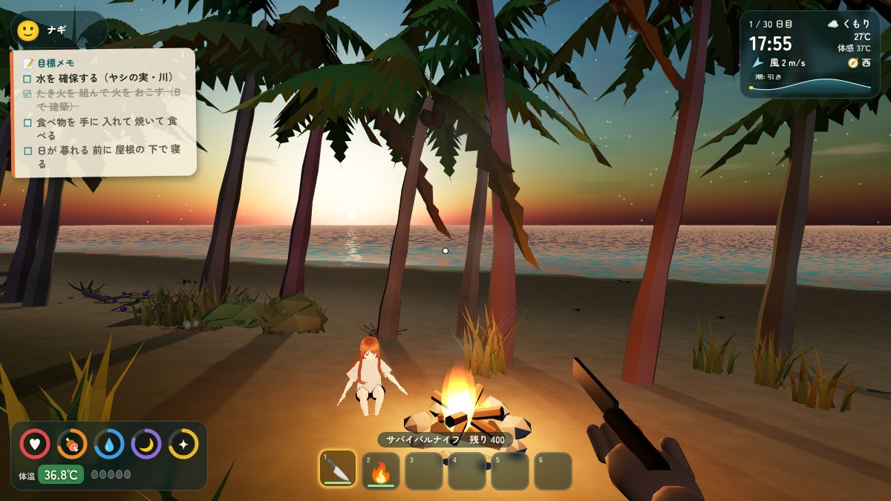

# ひとつだけ島 — ONE THING ISLAND



無人島に 持っていける 道具は ひとつだけ（0〜3 個・全部 も 選べる）。一人称の 無人島サバイバルです（three.js / MediaPipe / Gemini Live、ビルド不要）。
島の 地形・植物・動物・天気・病気は すべて コードで 生成し、島の シード（番号）が 同じなら 同じ 島に なります。

あそぶ：**https://tomy1031.github.io/lab/island-survival/**

キャラクター・植物・動物・音は すべて この作品の ための オリジナルで、形・色・音は コードで 生成しています（画像や 音声の 素材ファイルは 使っていません）。仲間の 3D キャラクター（VRM）だけ 素材を 使って います（下の「クレジット」）。

## あそびかた

1. ページを 開いて **はじめる** を 押す。Web カメラが あれば ハンドジェスチャーでも あそべます
2. **せってい** を えらぶ：
   - **持っていく数**：0（裸一貫）／ 1 ／ 2 ／ 3 ／ 全部
   - **持ち物**（15 種）：サバイバルナイフ・手斧・弓と矢・猟銃（弾 12 / 30 / 無限）・釣り竿・投網・火打ち石・鍋・テント・寝袋・ロープ・浄水ボトル・水中ゴーグル・救急箱・サバイバル図鑑
   - **仲間**：なし／ナギ／トウコ（ゲンは 準備中）
     - 仲間を 選ぶと **キャラクターシート** が 出ます。能力値（筋力・体力・器用・敏捷・知識・精神）は 毎回 ダイスで 決まります。🎲 で 何度でも 振り直せます。「職業は そのまま 振り直す」「ひとつ 前に 戻す」も 使えます
     - **職業**（漁師・植物学者・大工・看護師・料理人・猟師・ガイド・農家・会社員・学生、または おまかせ）で ダイスの 式と 技能の 範囲が 変わります。男女差・年齢差も 少し あります
     - 能力値で 持てる 重さ・歩く 速さ・食べる 量・寒さ暑さへの 強さ・病気の なりやすさ・夜の こわさ・仕事の 成果が 変わります。強い 仲間ほど スコア倍率は 下がります（×0.81〜0.99）
   - **日数**：3・7・14・30・60・100・無制限
   - **1 日の 長さ**：12〜72 分（現実の 時間）
   - **難易度**：4 段階
   - **季節**、**島のシード**（同じ 番号なら 同じ 島）
   - **操作**：マウス・キーボード／タッチ／ハンドジェスチャー
   - **Gemini API キー**（仲間との 会話に 使う。下の「API キーの 登録」）
3. 砂浜に 立って、島を 歩く。食べ物と 水を 探し、火を おこし、寝床を つくり、約束の 日まで 生きのびる
4. 船が 来る・合図を 送って 救助される・いかだで 脱出する、のいずれかで 島を 出る。途中で 力つきた ときは リタイア（死因の ふりかえり）に なります

## 操作

### PC（マウス・キーボード）

| 操作 | キー |
|---|---|
| 移動 | WASD |
| 走る | Shift |
| ジャンプ | Space |
| しゃがむ（忍び寄り） | Ctrl |
| 視点 | マウス |
| 拾う・調べる・行動 | E（ホイールで 行動を 切りかえ） |
| 道具を 使う（切る・突く・撃つ・投げる・竿を 振る） | 左クリック |
| 構える・弓を 引く・投げる力を ためる（猟銃は Shift で 息を 止める） | 右クリック |
| ホットバー | 1〜6 |
| 食べる・飲む | F |
| 持ち物 | Tab / I |
| 錬成 | C |
| 建築 | B |
| 図鑑 | K |
| 地図 | M |
| 日記 | J |
| 眠る | Z |
| 仲間と 話す（Gemini Live） | T |
| 仲間を 呼ぶ | G |
| ジェスチャー練習 | P |
| メニュー | Esc |

### ハンドジェスチャー（Web カメラ・MediaPipe）

映像は 端末の 中だけで 処理し、どこにも 送りません。

| 操作 | ジェスチャー |
|---|---|
| 採集 | つまむ・つかむ |
| 伐採・割る | こぶしを 振り下ろす |
| 釣り | 腕を 上げて 前へ 振り下ろして 投げる → ウキが 沈んだら 手を さっと 上げる → 指で 円を 描いて 巻く |
| 投網 | 手を 前へ 押し出して 投げる → つかんで 引く を くり返す |
| 弓 | 片手で つまんで 引き、はなす |
| 猟銃 | 指鉄砲（親指を 倒すか、手を 跳ね上げて 撃つ） |
| 槍 | 手を 前に 突き出す |
| 火おこし（きりもみ・弓ぎり） | 両手を こすり合わせる |
| 火打ち石 | こぶし同士を 打ち合わせる |
| 仲間を 呼ぶ | 手を 振る |

## しくみ

島で 生きる ための 仕組みを 重ねて います。数値は 企画書（`docs/DESIGN.md`）に 書いて あります。

- **体のパラメータ**：体力・満腹・水分・スタミナ・睡眠・体温・濡れ・気力。
  体感温度は 気温・日差し・風・濡れ・火・服・屋根で 決まります
- **天気と 潮**：6 時間ごとに マルコフ表で 天気が 変わります（乾季と 雨季、霧・猛暑・嵐・大嵐）。潮は 満ち引きで 海岸の 形と 釣りに 影響します
- **病気**：風邪・食中毒・水あたり・熱中症・低体温・化膿・寄生虫・毒。食中毒の 確率は 鮮度・加熱・保存・衛生・難易度で 決まり、水は 煮沸・ろ過で 安全に なります
- **島の図鑑**：植物と 動物は 未発見 → 見つけた → 調べた → 確定、の順に わかって いきます。似た毒の 植物は 束に 混ざって 生えて いて、確定すると 安全に 収穫できて 量も 増えます
- **錬成**：素材の 性質 21 種 × 手法 7 つ。型 64 個が あり、型に ない 組み合わせでも 何かが できます。品質と ランクも 付きます
- **建築**：たき火・炉・狼煙台・SOS・風よけ・差しかけ小屋・三角小屋・草の寝床・干し台・雨水受け・テント ほか。嵐で 傷みます
- **火**：火口・湿り・風・板の 材と 切り欠きで 成功率が 変わります。燃料が いり、雨で 消えます。熾火を 残して 次の 火に 使えます。焼き加減は 自分で 決めます
- **狩り**：動物は 視覚・聴覚・嗅覚（風向き）で 人に 気づきます。群れには 見張りが いて、6 部位の 当たり判定と 出血があります。手負いの 獲物は 血痕を 追って 探します。銃声で 島の 半分の 動物が 逃げます。矢は 弾道と 風の 影響を 受けます。解体の 収量は 道具しだいです
- **釣り**：時間帯・潮・天気・エサ・針の 大きさ・糸の 強さで 釣果が 変わります。投網は 水深と 網の 目で 捕れる 魚が 変わります
- **仲間**：VRM の 3D キャラクターです。手続きアニメーションと 表情・口パクで 動きます。定型の セリフも あります。Gemini Live の キーが あれば 声で 会話でき、ツールで 行動し、記憶は Live で 要約して 圧縮します
  - **協力度**：頼みを 聞くかどうかは 親密・信頼・危なさ・苦手・気力・体調で 決まる 確率です。断られた 頼みは しばらく 頼めません。嵐の 中の 仕事は 信頼 60 未満だと 断られます
  - **親密の 5 段階**（よそよそしい → ふつう → 打ち解けた → 仲良し → 親友・特別）で 口調・呼び方・話しかける 回数・仕事の 成果（×0.85〜1.2）が 変わります。食べ物の 分け方（自分の 分が 先 → 頼めば くれる → 自分から 渡す → 良い ほうを くれる → 空腹でも 半分 くれる）と、頼まれる 前に 動くかも 変わります
  - **職業の 特技** は そばに いる ときに 効きます（漁師：アタリ ×1.2、猟師：肉 ＋10%、ガイド：着火 ＋0.05 など）。Gemini Live の 会話でも 職業と 得意・苦手を 自覚して 話します
- **イベント**：漂着物・大嵐・船・魚の 大群 ほか
- **結末**：約束の 日の 迎え・合図で 救助・いかだ・リタイア。死因の ふりかえりも 出ます
- **スコア・実績**：結末ごとに 点数が つき、実績が 解除されます
- **セーブ**：自動で 保存され、「つづきから」で 再開できます

## API キーの 登録

仲間との 会話（Gemini Live）と 判定に 使う キーは、**あなたの キー** です。

1. [Google AI Studio](https://aistudio.google.com/apikey) で Gemini API キーを 作る（無料枠で 使えます）
2. ゲームの せってい の **Gemini API キー** の 欄に 貼り付ける
3. キーは **この ブラウザの localStorage だけ** に 保存され、Google の Gemini API（`generativelanguage.googleapis.com`）以外には 送りません。サーバーや GitHub には 置きません

- キーが ない ときも 遊べます。仲間との 声の 会話だけ できなく なります
- 別の ブラウザや 端末では、もう いちど 登録して ください

## 開発

ビルドは 不要です。静的ファイルを 配信すれば 動きます（カメラを 使うので `https://` か `http://localhost` で 開く）。

```sh
cd island-survival
npx serve                                            # 静的ファイルを 配信（ほかの 静的サーバーでも OK）
node -e "require('./island-survival/tests/serve.cjs')(8080)"   # リポジトリの ルートから 使う 場合
```

テスト（Node）：

```sh
node tests/sim.mjs        # 体・天気・火などの シミュレーション
node tests/gestures.mjs   # ハンドジェスチャーの 判定
node tests/crafting.mjs   # 錬成
node tests/building.mjs   # 建築
node tests/events.mjs     # イベント
node tests/sheet.mjs      # 仲間の キャラクターシート（ダイス・職業・男女差・派生値）
node tests/companion.cjs  # 仲間の 協力度・仕事・分け合い・段階・保存（headless Chromium）
node tests/play.cjs       # headless Chromium で 通しで 遊ぶ（playtest）
```

URL の オプション（テスト・確認用）：

| オプション | 内容 |
|---|---|
| `?quick` | メニューを 飛ばして すぐ 始める |
| `?quality=low\|mid\|high` | 画質 |
| `?nosound` | 音を 鳴らさない |
| `?seed=N` | 島のシード |
| `?starter=knife,firesteel&count=2` | 持ち物と 持っていく 数 |
| `?companion=nagi` | 仲間 |
| `?prof=nurse&aff=60` | 仲間の 職業と 最初の 親密（テスト用） |

## 作り方

企画書 `docs/DESIGN.md` は Fable が 書き、実装は 次の 分担で 進めました（Claude のマルチモデル）。

- **Opus**：体・天候・火・釣り・狩り・仲間・統合
- **Sonnet**：植生・効果音・UI・アイテム表・建築・イベント
- **Haiku**：図鑑・仲間の セリフ・この README

## クレジット

- VRM モデル
  - 「Seed-san」model by VirtualCast, Inc.（VRM Public License 1.0、クレジット表記 必須）
  - 「VRM1_Constraint_Twist_Sample」 (c) 2022 pixiv Inc.（VRM Public License 1.0）
  - 詳しくは `assets/companions/LICENSE.md`
- three.js（MIT）
- @pixiv/three-vrm（MIT）
- MediaPipe Tasks Vision（Apache-2.0）

それ以外（地形・植物・動物・音）は すべて コードで 生成しています。
