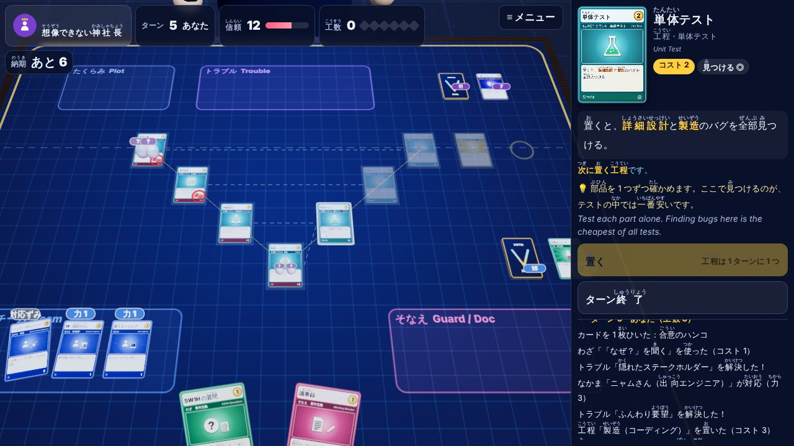
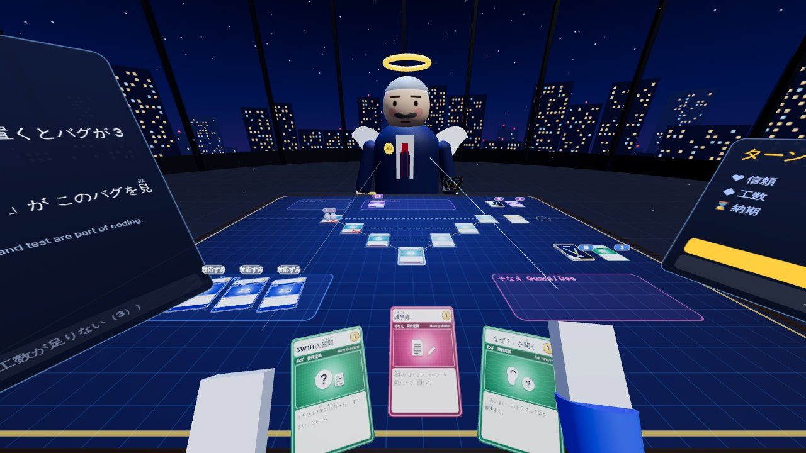

# KOTEI DUEL 工程デュエル — V字の 約束

日本の IT 企業で システムを つくる **工程**（要件定義 → 見積もり → 基本設計 → 詳細設計 → 製造 → 単体・結合・受入テスト → リリース → 運用・保守）と、それぞれの 工程で **大切に すること**・**よくある 失敗** を、デュエル・カードゲームで 体で 覚える 研修用の ゲームです（three.js + WebXR、ビルド不要、**オフライン対応**）。**PC・スマホ** と **VR（Meta Quest）** の 両方で 遊べます。

机の **V字** に 工程カードを 左から 置いて リリースまで 進め、運用の ターンを 守りきれば プロジェクト成功。相手は お客さまの 神社長（IT を 知らないので、ふんわり・思いつき・値切りが 出てしまう）や、デスマーチ・バグキング・本番の魔物 ショウガイ といった「よくある 失敗」の 化身です。ルールそのものに 現場の 教えが 入っているので、説明を 読まなくても「要件定義を とばすと あとで 痛い」「バグは 早く 見つけるほど 安い」「設計と テストは V字で 対に なる」「仕様変更は 変更管理で 受ける」「悪い 報告ほど 早く」「本番作業は 手順書と ダブルチェック」「リリース後も 運用が つづく」が 遊びながら わかります。

日本語は やさしい 日本語（JLPT N4 程度）で、漢字には すべて ふりがな（設定で 消せる）、英語の 補助文 つき。カード・絵・音は すべて オリジナルで、コードで 描いて います。



## 学べること

| 工程 | 大切なこと | ゲームの 中で どう 体感するか |
|---|---|---|
| 全体 | 開発は 順番に 進む。前の 工程が 次の 土台 | V字に 左から 1 ターンに 1 つずつ 置く。テストと リリースは 製造の あと |
| 全体 | **V字モデル**（設計 ⇔ テスト） | テストは 同じ 高さの 設計工程の バグだけを 見つける。盤面の 点線が ペアを 結ぶ |
| 全体 | **バグは あとで 見つけるほど 高い** | 見つかっていない バグは 工程が 進むたび 2 倍（1→2→4→8）。直す 工数＝大きさ。作って すぐの レビューなら 1 |
| 要件定義 | **要件定義を とばすと あとで 痛い** | とばした 設計工程は「穴」に なり、バグ 2 つが テストでも 見つからず、本番障害（大きさ 8）に |
| 要件定義 | あいまいな 言葉を はっきり／なぜを 聞く | 「ふんわり要望」が いる 間は 設計に 入る バグ +1。「なぜ？」を 聞く・5W1H で 先に 解決 |
| 要件定義 | **合意（承認）してから 進む** | 承認の ハンコ（工数 1）が ある 工程は、あいまいな カード（言った言わない・ちゃぶ台返し）で こわされない |
| 見積もり | 積み上げ・バッファ・根拠 | 工数と 納期が 資源。値切り・無茶な 納期に「見積もりの 根拠」「バッファ」で 答える |
| 管理 | **仕様変更は 変更管理で 受ける** | 「変更」は 承認ずみでも バグを 入れる。止められるのは 変更管理だけで、**承認ずみの 工程が ないと 使えない**（基準が あるから 変更と 言える） |
| 製造 | 読める コード／「動いた」は 完成ではない | 製造は バグ 3 つ。レビューは 1 ターン 1 回なので、テストまで 残る バグが 出る |
| 管理 | 急ぐと かえって 遅れる | 残業・突貫作業は 得に 見えて、バグと 疲れで あとから 高くつく |
| 報連相 | **悪い 報告ほど 早く** | 出たばかり（NEW）の トラブルは「すぐ報告」（コスト 0）で 消せる。抱え込むと 攻撃の たびに 育つ |
| テスト | リストで もれなく／具体的な バグ報告／再テスト | 見つけた バグしか 直せない。テストの あとに 入った バグは「？」の まま |
| リリース | **手順書・ダブルチェック・切り戻し** | 相手の「たくらみ」（設定値の ミス・古い 手順書・切り替わらない 予備機・金曜の 夕方）は リリースの 瞬間に 発動 |
| 運用 | **リリース後も 仕事は つづく** | リリースしても 勝ちでは ない。運用の ターンを 守りきって 勝ち。残った バグは 本番障害として 攻めてくる |

調べた ことと 出典は [docs/RESEARCH.md](docs/RESEARCH.md)（IPA・JUAS・Boehm、東証・みずほ・KDDI などの 障害事例）、ルール・カード・章・教訓・クイズの すべては [docs/DESIGN.md](docs/DESIGN.md)。ネクストメイク 入社研修の 教材（システム開発の流れ・WATER FALL QUEST・既存の IT DUEL MONSTERS）の 学びを、自分の 言葉で 書き直して 使って います。

## 遊び方

### PC・スマホ

1. **https://tomy1031.github.io/lab/kotei-duel/** を 開いて「PC・スマホで はじめる」（最初は 第 1 章の チュートリアル）
2. カードや マスを **押して 選ぶ** → 光っている 所を 押すか、右の パネルの ボタンを 押す
3. 右の パネルに、選んだ カードの 説明（ふりがな つき）・今 できること・ログ。スマホを 縦に 持つと 下に 出ます

| したい こと | 操作 |
|---|---|
| 工程を 置く | V字の 光っている マス（次の 工程）を 押す →「置く」。先の マスを 選ぶと「とばして 置く」 |
| 手札を 出す | 手札を 押す →「出す／使う／ふせる」。トラブルに 使う わざは、光る トラブルを 押す |
| 対応（なかまで トラブルの 圧力を 下げる） | なかまを 押す → 光る トラブルを 押す |
| レビュー／承認 | 置いた 工程を 押す →「レビュー」「承認（ハンコ）」（どちらも 工数 1） |
| バグを 直す | 見つかった バグ（赤い 虫）を 押す →「バグを 直す」 |
| わりこみ | 相手の 行動に 合う そなえが あると、「発動する／しない」を 聞かれる |
| ターン終了・やめる | 「ターン終了」（E キー）／右クリック・Esc で 選ぶのを やめる |

### VR（Meta Quest）

1. Quest の ブラウザで 同じ アドレスを 開いて「VR で はじめる」。座っても 立っても 遊べます。机は 自動で あなたの 目の 45 cm 下に 合います（メニューの「机を 合わせる」で やり直し）
2. 正面の 板で 章を 選ぶ。**レーザーで 指して 引き金**（ハンドトラッキングは 親指と 人差し指で つまむ）
3. 手札は 手元に 扇の 形で 浮かびます。左の 板に 指した カードの 説明と ボタン、右の 板に 信頼・工数・納期と「ターン終了」
4. **B / Y** で 選ぶのを やめる。教訓・わりこみ・クイズは 正面の 板で 読んで 押す



## 2 分で わかる ルール

1. 机の **V字** に **工程カード** を 左から 順番に 置いて、**リリース** まで 進める。リリースの あと、決まった ターンの あいだ **信頼** を 守れば 勝ち
2. 工程を 置くと **バグ** が 入る。バグは 工程が 1 つ 進むたびに **2 倍**。**レビュー** ですぐ 直すのが 一番 安い（工数 1）。V字の **向かい側の テスト** で 見つけて、**大きさと 同じ 工数** で 直す。残したまま リリースすると **本番障害**
3. 相手は **トラブル** を 出す。トラブルは 毎ターン **圧力** の 数だけ 信頼を 減らす。**なかま** で「対応」して 下げる。NEW の トラブルは「すぐ報告」で 消せる
4. **そなえ** を ふせておくと 相手の カードに **わりこみ** できる（4 枚まで 連続。あとから 出た ものから 解決）。工程に **承認** を もらうと あいまいな 要望で こわされない
5. 信頼が 0 で 負け。**納期** までに リリースできないと 毎ターン 信頼が 減る（2、3、4…）

工数は 毎ターン 3 → 4 → 5 → 6 と 戻り、使い残しは 持ちこせません。勝つと ★（信頼 12 以上で ★2、本番障害 0 で 納期どおりなら ★3）。

## 章

| 章 | 題名 | 相手 | V字 | 新しく 学ぶ こと |
|---|---|---|---|---|
| 1 | はじめての案件（チュートリアル） | せっかちな 神社長 | 小さな V（設計・製造・テスト・リリース） | V字・バグの 2 倍・レビュー・すぐ報告・わりこみ。案内役の ヘンディ先輩と 一手ずつ |
| 2 | ふんわりした要望 | ふんわりした 神社長 | 中くらいの V（＋要件定義・受入テスト） | 「なぜ？」を 聞く・5W1H・合意の ハンコ・議事録 |
| 3 | 値切りと無茶な納期 | ねぎってくる 神社長 | 中くらいの V | 見積もりの 根拠・バッファ・フェーズ 2 の 提案 |
| 4 | 「思っていたのと違う」 | 想像できない 神社長 | 本物の V（7 工程） | 基本設計 ⇔ 結合テスト、詳細設計 ⇔ 単体テスト、要件定義 ⇔ 受入テスト。画面は 絵で 見せる |
| 5 | デスマーチの影 | 炎上の化身 デスマーチ | 本物の V | 相談・連絡・コーディング規約・CI・無理な 計画の こわさ |
| 6 | バグキングの城 | バグキングと 思いつきの 神社長 | 本物の V | テスト仕様書・バグ票・再テスト・変更管理 |
| 7 | 本番の夜 | 本番の魔物 ショウガイ | 本物の V | リリース手順書・ダブルチェック・切り戻し計画・リハーサル |
| 8 | 運用はつづく | ショウガイ（運用編） | リリース後から | 監視・ログ分析・なぜなぜ分析・改善提案。6 ターン 守る |
| 9 | 通しプロジェクト：ゴッドマート・アプリ | 神社長（本気） | 本物の V | すべての 総まとめ。3 ターン 運用 |

章を クリアすると 次の 章が 開きます（設定「すべて ひらく」で 研修の 先生は 自由に 選べます）。デュエルの あとは **ふりかえり クイズ**（章ごとの 問題から 3 問）、集めた **現場の 教訓**（33 枚）は タイトルの「教訓図鑑」で 読み返せます。

## 設定

ふりがな（あり／なし）、英語の 補助、演出の 速さ（ふつう・はやい・ゆっくり）、試合中の 教訓（くわしく／題名だけ）、むずかしさ（信頼 20／24）、音楽、効果音、章（順番に ひらく／すべて ひらく）。設定と 進み具合（★・教訓・クイズ）は この 端末に 保存されます。

## しくみ

- **ルールの エンジン**（`js/engine.js`）は 画面を 持たず、起きたことを 1 つずつ イベントで 知らせます。PC も VR も 同じ エンジンと 同じ 演出（`js/main.js` の `present`）を 使い、わりこみの「発動する／しない」だけ 返事を 待ちます。乱数は seed つきで、同じ seed と 同じ 操作なら 同じ デュエルに なります
- 設計の とき 作られた **参照エンジン**（`tools/ref/engine.mjs`）と、ボットで 1 試合ずつ 突き合わせて、結果（勝敗・ターン・信頼・修正の 工数）が すべて 一致する ことを テストで 確かめて います
- 3D は three.js だけで、カードの 面・絵・机・部屋・相手の 像・演出を すべて コードで 描いて います（画像ファイルは アイコンだけ）。音は Web Audio で 合成
- 一度 開けば Service Worker が すべての ファイル（30 個）を 保存し、ネットが なくても 動きます（新しい 版が あれば「更新する」）

ゲームの 細かい 設計（ルール・90 枚の カード・9 章・33 の 教訓・48 問の クイズ・チュートリアルの 台本・バランス）は Fable、実装は Opus が 担当しました。

## ファイル

| ファイル | 内容 |
|---|---|
| `js/data/cards.js` | 90 枚の カード（工程・なかま・わざ・そなえ・資料・トラブル・イベント・たくらみ）と 効果の 部品 |
| `js/data/chapters.js` | 9 章（相手・山札・ルールの 数値・台詞）と V字の 形（小さな・中くらいの・本物の） |
| `js/data/lessons.js`・`quiz.js`・`tutorial.js` | 現場の 教訓 33・クイズ 48 問・チュートリアルの 台本 28 手と ヒント |
| `js/engine.js` | ルール（ターン・工程・バグ・テスト・承認・わりこみ・リリース・運用・CPU） |
| `js/bot.js` | 自分で 遊ぶ プレイヤー（タイトルの デモと テスト） |
| `js/main.js` | 流れ（タイトル → 章 → デュエル → 結果 → クイズ）、選んで 動かす、演出、チュートリアル |
| `js/table.js` | 机の V字・カード・バグ・ハンコ・山札 |
| `js/cardmesh.js`・`faces.js`・`art.js`・`text.js` | カードの 3D と 面、コードで 描く 絵、ふりがな つきの 文字 |
| `js/ui.js`・`vrui.js` | PC の 画面（HUD・パネル・ダイアログ）と VR の 板 |
| `js/room.js`・`avatar.js`・`fx.js`・`audio.js` | 夜景の 会議室、相手の 像、演出、音 |
| `js/core.js`・`input.js` | 描画・WebXR・机合わせ・オフライン、マウス／タッチ／レーザー／ハンドトラッキング |
| `sw.js`・`tools/bundle.mjs` | オフライン用の Service Worker と、公開用の 組み立て |
| `docs/DESIGN.md`・`docs/RESEARCH.md` | 設計書（データから 自動で 作る 表を ふくむ）と 調査 |

## 開発

```bash
cd kotei-duel
npm i                  # テスト用（iwer：Meta の WebXR エミュレーター）
npm run serve          # http://127.0.0.1:8080/
npm test               # ルール → PC → VR（エミュレーター）→ オフライン
```

| テスト | 内容 |
|---|---|
| `tools/sim.mjs` | データの 検査（全部の 漢字に ふりがな・id・効果・絵・長さ）、参照エンジンと 1 試合ずつ 一致、学びの 向き（ていねい ＞ とばす ＞ ざつ）、決定性、必ず 終わる、バグの 2 倍・V字の ペア・穴・承認・変更管理・4 枚の わりこみ・リリース失敗・納期遅れ・手戻り・チュートリアルの 台本 |
| `tools/smoke.mjs` | PC：タイトルと デモ、第 1 章を 画面から 最後まで（最初の 一手は 3D の カードを マウスで クリック）→ 結果 → クイズ、第 2〜9 章を ボットが 実際の 画面で 完走、ふりがなの 設定、スマホの 縦画面 |
| `tools/xr.mjs` | Meta Quest 3 の エミュレーター：VR に 入る → 板の メニューを レーザーで → 机合わせ → 工程を 置く → 手札を 出す → B で 取り消し → ターン終了 → ハンドトラッキングの つまみ → VR を 終わる |
| `tools/offline.mjs` | 公開用に 組み立て、一度 開いた あと ネットも サーバーも 止めて 再読み込み、タイトルと デモが 動き、第 1 章で 工程を 置ける |

`tools/icons.mjs` で アイコン、`tools/shots.mjs` で `docs/preview.jpg` と `docs/vr-view.jpg` を 作ります。データを 変えたら `node tools/ref/gen.mjs 1000` で 設計書の 表と バランスの 数字を 作り直せます。

VR で 遊ぶ ときは、まわりに 物や 人が ない ことを 確かめ、気分が 悪く なったら すぐ 休んで ください。
