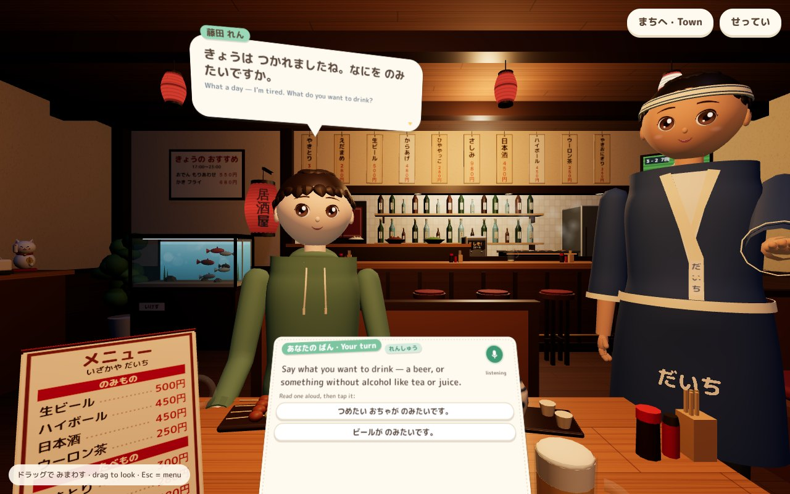
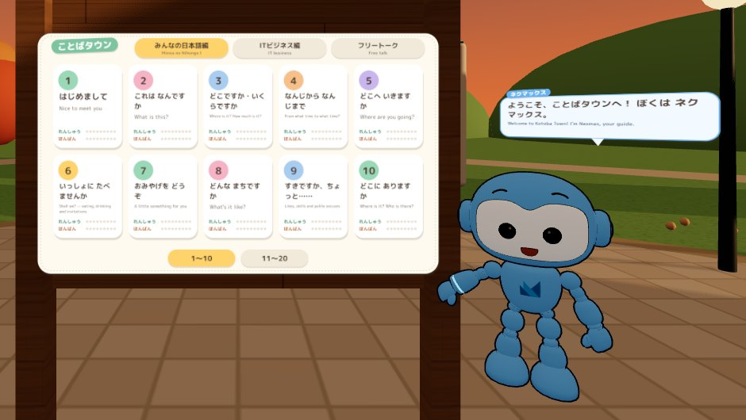

# ことばタウン — Kotoba Town



VR の まちで、日本語を **声に 出して** 練習する アプリです（three.js r186 + WebXR、ビルド不要）。
2 つの コースと、台本の ない **フリートークの 部屋** が あります。

- **みんなの日本語編**：『みんなの日本語 初級I』第1課〜第20課の 文法に 合わせた 60 の 場面（各課 3 パターン）
- **ITビジネス編**：IT の 会社「みどりデザイン」の 新人エンジニアと して、報連相・朝会・要件ヒアリング・認識合わせ・
  相談・遅れの 報告・仕様変更・障害の 電話・エスカレーション・お詫びと 説明・ふりかえり を 練習する 10 話（各話 2 パターン）。
  2 つの 話（喫茶さかもとの 予約アプリ → デパートの ネットショップ トラブル）が、同じ 人たちと 順に 進みます。
  さらに **面接**（第11話 ふつうの 面接・第12話 圧迫面接）で、就職の 面接を 入室から 退室まで 練習できます
- **フリートーク**：まちの 人 20 人から 相手を えらび、場所（13 か所）・話題（65）・レベル（やさしい N5／ふつう N4／むずかしい N3）・
  話し方（ていねい／ともだち）を 決めて、**台本なしで** 自由に 話します。「🎲 おまかせ」で 全部 ランダムにも できます。
  相手は Gemini Live が その人の 声と 性格で 演じ、こちらの 話に 返事を し、自分の ことも 話し、質問を 返して きます。
  話の 途中で ちょっとした できごと（雨が ふって くる・電話が 鳴る など）が 起きる ことも あります。
  一言ごとに「こう いうと もっと いい」を カードに 出し、おわると ふりかえり（よかった ことば・直すと いい ところ・つぎに 使える ことば）を 見せます。
  **Gemini Live の キーが 必要**です（台本が ないので、オフライン練習は ありません）

まちの 人（NPC）が 話しかけて きます。あなたが 日本語で 答えると、**Gemini Live** が 聞いて 判定し、
答えの 内容で 会話が 分かれます。台本に ない ことを 言うと、相手が Gemini Live の 声で その場で 返事を します。

- Meta Quest 2 / 3 の ブラウザ（VR）と、PC の ブラウザ（マウス）で 遊べます
- マイクは スタートを 押した ときに オンに なり、会話の あいだ ずっと オンです（相手が 話して いる あいだだけ 自動で 止めます）
- 判定・ふりかえり（評価文）は 英語、会話は 日本語です
- 聞き取りは 日本語に 決めて います（なまりの ある 日本語を ほかの 言語と まちがえない ように、Gemini Live に 「日本語」と 場面の ことばを 渡します）
- UI は どうぶつの森のような、まるくて やさしい 見た目に しています

## 遊び方

1. `kotoba-town/index.html` を 開く（公開後は https://tomy1031.github.io/lab/kotoba-town/ ）
2. **せってい** で Gemini API キーを 登録する（下の「API キーの 登録」）
3. **VRで はじめる**（Quest）または **PCで はじめる**
4. まちの 広場の 掲示板で コース（みんなの日本語編／ITビジネス編）と 課・話を えらび、場面を 1 つ えらぶ
5. 説明カードを 読んで、**れんしゅう** か **ほんばん** を 押す → 相手が 話しかけて くる
   - **れんしゅう**：答えの 例が 最初から 出ます。読んで 言っても、自分の 言葉で 言っても かまいません。ヒントも 使えます
   - **ほんばん**：例も ヒントも 出ません。聞いて 答えるだけです（Gemini の キーが 要ります）
   - 星は れんしゅうと ほんばんで 別々に 残ります。ITビジネス編では、終わると「つぎの 話へ」が 出ます
6. カードが **あなたの ばん**（緑の マイク）に なったら、日本語で 答える
7. 答える たびに ★（0〜3）と 直した 文・英語の ヒントが 出ます。さいごに Gemini Live の ふりかえり（英語）が 出ます

困った ときは 声で「もう いちど おねがいします」「わかりません」と 言えば、相手が くり返したり、ゆっくり 言ったり、ヒントを 出したり します。
れんしゅうでは カードの **ヒント**（文の 形）、**もういちど**、**スキップ** も 使えます。ほんばんは **もういちど きく** と **スキップ** だけです。

| 操作 | PC | Quest |
|---|---|---|
| 見回す | ドラッグ／←→ | 頭を 動かす・右スティックで 30° ずつ 回る |
| えらぶ | クリック | 指す ＋ トリガー（ハンドトラッキングは ピンチ） |
| メニュー | Esc | A／X ボタン |

## API キーの 登録（大事）

**アプリで 会話・判定に 使う キー（あなたの キー）**

1. [Google AI Studio](https://aistudio.google.com/apikey) で Gemini API キーを 作る（無料枠で 使えます）
2. アプリの 最初の 画面で **せってい · Settings** を 押す
3. **Gemini API key** の 欄に 貼り付けて **つながるか テスト** → `✓ OK — gemini-3.8-live` と 出れば OK
4. **ほぞん · Save**

- キーは **その ブラウザの localStorage（`kotoba.geminiKey`）だけ**に 保存され、Google の Gemini Live API（`generativelanguage.googleapis.com`）以外には 送りません。サーバーや GitHub には 置きません
- **Quest で 遊ぶ ときは、Quest の ブラウザで 1 回 登録**して ください（PC と Quest は 別の ブラウザなので 共有されません）。Quest の ブラウザでも キーボードで 貼り付けできます
- キーが ない ときは「オフライン練習」に なります：答えの 例を 声に 出して 読み、カードの ボタンを 押して 進みます（判定は 簡易版）

**作り置きの 声を 作る キー（GitHub Actions 用）**

NPC の 決まった セリフ（みんなの日本語編 557 行・ITビジネス編 480 行）は、[tomy1031/nexmax-academy](https://github.com/tomy1031/nexmax-academy) の GitHub Actions で
Gemini Live に 読ませて 作りました。そこの キーは すでに **nexmax-academy の Settings → Environments → `Preview` の Secret `GEMINI_API_KEY`**
に 登録されて います（教材の 音声づくりと 同じ もの）。新しく 登録する 必要は ありません。

## しくみ

```
lesson JSON（data/lessons/l01〜l20.json）── Fable が ネットで 調べて 書いた 台本（各課 3 場面・分岐つき）
freetalk.json ── フリートークの 相手（20 人）・話題（おしゃべり 42・ロールプレイ 23）・できごと（24）。台本では なく Gemini Live への 指示
  │
  ├─ 声：nexmax-academy の Actions → Gemini Live で 読み上げ → 文字起こしで 台本と 照合 → mp3（audio/voice/）
  │
  └─ ゲーム（js/）
       Stage   … 場面（js/world/scenes/*.js）・人物（js/people/person.js）・環境音
       Runner  … 台本を 進める。NPC の セリフは 作り置きの 声で 再生
       LiveBrain … 場面ごとに Gemini Live と 1 本 つなぐ（WebSocket）
                   学習者の 声を 16kHz PCM で 流し、話し終わる たびに judge_reply（関数呼び出し）で
                   「どの 分岐か・0〜3 点・直した 文・英語の ヒント」を 返させる
                   台本外の 発言には 相手の 声で 1 文 返事（say: "react"）。さいごに final_report
```

- **判定は Gemini Live**（関数呼び出し `judge_reply` / `final_report`）。プロンプトと 関数の 定義は `js/talk/judge.js`、つなぎ方は `js/talk/live.js`・`js/talk/brain.js`
- モデルは `gemini-3.8-live` → `gemini-3.1-flash-live-preview` → `gemini-2.5-flash-native-audio-preview-12-2025` → `gemini-2.5-flash-live` の 順に ためします（せっていで 固定も できます）
- **本物の API で 確かめました**（nexmax-academy の ワークフロー `Kotoba Town e2e`）
  - self-check：ブラウザ用の コード（`js/talk/*.js`）を Node で 動かし、Live TTS で 作った 学習者の 声を マイクと 同じ 形で 流す。
    自己紹介・名前だけ・「もう いちど おねがいします」・英語・相手への 質問の どれも 正しい 分岐に なり、
    台本外の 質問には 相手が 短く 答えた（「トイレは どこですか」→「トイレは あちらです。」）
  - 通し試験：本物の ブラウザ（Chromium）で アプリを 開き、合成した 学習者の 声を 偽マイクに して 第1課の 会社の 場面を 会話。
    `gemini-3.8-live` が 判定し、「アメリカの かたですか」への「ベトナムから 来ました」を「アメリカ人では ない」の 分岐に 進めた
- 人物は 手続き的に 作った ローポリの 3D モデル（骨組み＋GPU スキニング。1 人 約 8,000〜11,000 三角形・2〜3 ドローコール）。やわらかい おもちゃの ような 見た目です。まばたき・目線・口の 動き（音量から）・おじぎ・うなずき・指さし・手わたし などの しぐさ。まちの 人は 20 人で、課を こえて 何度も 出て きます（`js/content/cast.js`）
  - 頭は 少し 大きめ（頭身 約 4.7）、からだは まるみの ある 形。手は まるい ミトンの 形で、指さしの ときは 人さし指が 出ます。服には えり・ボタン・ポケット・ネクタイ・名札・ベルトなどの 細かい ところが あり、くつも 服や 年れいで 変わります。白衣（石田先生）と はっぴ・はちまき（中野さん）も あります
  - 一人ひとりに ふだんの 表情が あります（黒岩さんは きびしい 顔、中野さん・アナさんは 明るい 顔、石田先生は おだやかな 顔 など）
  - 顔は 頭そのものに シェーダーで 描いて います（`js/people/face.js`）。大きな ひとみ・大小 2 つの 光の 点・まつげの 線・小さな まゆ・影だけの 鼻・ほおの 赤み・口。形の 式（距離場）で 描くので VR で 近づいても ぼやけず、まばたき・目線・口の 動き・表情は 数値を 変える だけです
  - 髪は 頭に そった なめらかな ひとかたまりに、大きな 前髪・横の ふさを 足して 作ります（`js/people/hair.js`）。光と 色は やわらかく あたたかい ぬいぐるみ・ねんどの ような 質感に しています


### 案内役の ネクマックス



NEXT MAKE の ロボット **ネクマックス** が 案内役です（モデルは lab の「ハマころ！」と 同じ `js/vendor/nexmax.js`）。
- 町の 広場では 掲示板の よこに うかんで、はじめての ときは あいさつ、そのあとは 1 回に 1 つ ヒントを 言います（フリートークの タブでは「まよったら おまかせ！」）
- 場面の 中では 小さく なって 左に います。相手が 話して いる あいだは しずかに して、最初の ばんで「マイクは オン！」、いい 答えには ジャンプして よろこび、うまく いかない ときは はげまします。ほんばんでは 判定が わからない ように 何も 言いません
- せってい の「ネクマックスの あんない」で 消せます
- 場面の 文法の 位置関係（これ／それ／あれ、ここ／そこ／あそこ）は 小道具の 置き場所（near／npc／far）で そろえて います

## 内容（60 場面）

| 課 | 場面 |
|---|---|
| 1 はじめまして | 会社の 初日・日本語学校の 初授業・カフェで 人ちがい |
| 2 これは なんですか | となりの 森さんに あいさつ・忘れ物（だれの かさ？）・名刺 |
| 3 どこですか・いくらですか | デパートの ワイン売り場・会社の 案内・きっさてんの コーヒー |
| 4 なんじから なんじまで | 美術館に 電話・閉館 20 分前・月曜の 朝 |
| 5 どこへ いきますか | 駅で 電車を たずねる・公園の ベンチで 原さんと・週末の 話 |
| 6 いっしょに たべませんか | ラーメンの さそい・お花見・マスターと 朝の コーヒー |
| 7 おみやげを どうぞ | 森さんの いえ・誕生日の つぎの 日・テストの 朝 |
| 8 どんな まちですか | 晩ごはんの あと・桜の 公園・部長と 話す |
| 9 すきですか、ちょっと…… | コンサートの さそい・日曜の 晩ごはん・どうして 日本語を？ |
| 10 どこに ありますか | 雨の 夜の コンビニ・森さんの いえで 探し物・この 近くに…… |
| 11 いくつ？ どのくらい？ | コンビニで おにぎりと 切手と 荷物・ご家族は 何人？・どのくらい 勉強しましたか |
| 12 どうでしたか | お祭りは どうでしたか・どちらが いいですか（デパート）・大阪出張の あと |
| 13 なにが ほしいですか | 居酒屋「だいち」で 注文と 会計・夏の 週末・雨の 日の デパート |
| 14 てつだいましょうか | 雨の 朝の 駅（きっぷの 買い方）・会議の 前・ポストの 紙 |
| 15 しゃしんを とっても いいですか | 雨の 日の 美術館・森さんの うち（住んで います）・会社の ルール |
| 16 どうやって いきますか | きっぷを 買って、電車に 乗って・公園で 友だちを 待つ・わたしの 町 |
| 17 しんぱいしないで ください | 病院（のどが いたい）・木曜日の 5時までに・ごみの 日 |
| 18 しゅみは なんですか | 雨の 日の ジャズ・国際パーティー・晩ごはんの 前に |
| 19 のぼったことが ありますか | 居酒屋で かんぱい・月曜日の 朝・病院（もう よく なりました） |
| 20 友だちの ことば | 公園で お花見（ふつう形）・友だちと 居酒屋・友だちと 部長（話し方の 切りかえ） |

### ITビジネス編（12 話・各 2 パターン）

| 話 | 内容 | 場所・人 |
|---|---|---|
| **喫茶さかもとの 予約アプリ** | | |
| 1 朝会で 報告する | きのう・きょう・困って いる こと（順調／エラーで 困って いる） | 会社・村上・藤田・青木 |
| 2 要件を 聞く | 何を・何人・何時から・いつまで を 聞いて 復唱（はっきり／「いい感じに」） | 喫茶店・坂本・村上 |
| 3 認識を 合わせる | 要件を まとめて 確かめる（同じ／1つ ちがう） | 会社・村上・青木 |
| 4 先輩に 相談する | 状況→試した こと→聞きたい こと（すぐ／先輩が いそがしい） | 会社・藤田 |
| 5 遅れを 報告する | 結論→理由→対策→見通し（3日／リリースに ひびく。部長も） | 会社・村上・小川 |
| 6 デモと 仕様変更 | デモ、お願いを 受ける（小さな 変更／大きな 変更は 持ち帰る） | 喫茶店・坂本・村上 |
| **デパートの ネットショップ トラブル** | | |
| 7 障害の 第一報（電話） | いつから・どこ・何件・今も、復唱、次の 連絡の 時間（0円／支払えない） | 会社（電話）・西村 |
| 8 上司に エスカレーション | 何が・影響・して いる こと・お願い（落ち着いて／きびしい 質問） | 会社・小川・藤田 |
| 9 お客さまに 説明する | お詫び→原因→対応→再発防止（わかって もらえる／心配して いる） | デパート・西村・村上 |
| 10 ふりかえり（KPT） | Keep・Problem・Try、新人として 大変だった こと | 会社・村上・藤田・青木 |
| **就職の 面接** | | |
| 11 ふつうの 面接 | ノック→入室→名乗る→着席→自己紹介→志望動機→経験→強み・弱み→将来→逆質問→お礼・退室（一次面接／最終面接） | 面接室（みどりデザイン）・村上・藤田／小川・村上 |
| 12 圧迫面接 | 否定や 深掘り、答えにくい 質問にも 落ち着いて 答える。最後に 面接官が わざと 厳しく した ことを 明かす（否定と 深掘り／2対1・答えにくい 質問） | 面接室（くろがねシステム）・黒岩／黒岩・白石 |

面接は 面接官の 目で 評価します。答えるたびに（れんしゅう）、または 最後に まとめて（ほんばん）、
8 つの 基準（入退室・あいさつ／結論から／具体的に／会社と 結びつける／ことばづかい／長さ・わかりやすさ／前向きな 姿勢／落ち着き）で
良かった 点・直す 点・言い直しの 例を 出し、最後に「つぎに すすめそう／もう 一歩／まだ きびしい」の 判定と 基準ごとの 点を 出します。
判定も 評価も Gemini Live（`gemini-3.8-live`）です。Live の Extended Thinking モデル（`gemini-3.8-live-extended-thinking`）は
いまは 関数呼び出しが 届かない（最新の google-genai 3.4.0 でも 同じ）ため ふだんは 使いません（せっていの `liveThinking` で ためせます）。

調査メモ（出典つき）は `docs/research/`、台本の 書き方は `docs/SCENARIO_SPEC.md`（みんなの日本語編）と
`docs/BUSINESS_SPEC.md`（ITビジネス編・話の 流れと 共通の 事実）、場面の 作り方は `docs/SCENE_BUILDING.md`。

## オフライン

公開版（https://tomy1031.github.io/lab/kotoba-town/ ）は、一度 開けば 次からは **ネットなしでも 開けます**（PWA。Quest の ブラウザでも 同じ。アプリとして 追加も できます）。
ネットが ない ときは Gemini Live に つながらないので、場面は **オフライン練習**（例文を 声に 出して 読み、カードを 押して すすむ）に なります。
フリートーク・ほんばん・Gemini の 判定と ふりかえりは ネットが 必要です。

- まち・場面・台本・プログラム（約 5 MB）は、最初に 開いた ときに ぜんぶ 保存されます。three.js は `js/vendor/three/` に 同梱しています。
  保存できると、最初の 画面に「✓ オフラインでも れんしゅう できます」と 出ます
- まちの 人の 作り置きの 声（1,554 行・約 36 MB）は、**聞いた ものから 自動で 保存**されます。ぜんぶ 先に 保存する ときは
  **せってい → 「こえも ぜんぶ ほぞん」**。保存して いない 声は、オフラインでは ブラウザの 音声合成（あれば）か 字幕だけに なります
- 声は `audio/voice/<行>.mp3?v=<録音の ハッシュ>` で 読むので、声を 作り直すと 新しい 声が 読まれ、使われなく なった 古い 声は 次の 版で 消えます
- VR の コントローラーの 模型（Quest 2 / 3 / Pro）は、VR が 使える ブラウザで 開くと 保存されます。文字（M PLUS Rounded 1c）は 一度 表示した 分が 保存されます
- 新しい 版が 出ると、最初の 画面に「新しい バージョンに 更新」が 出ます
- 開発用の サーバー（`node tests/serve.mjs`）では サービスワーカーは 動きません。公開用の コピーは `npm run build`（`node tools/bundle.mjs dist`）で 作ります

| ファイル | 内容 |
|---|---|
| `sw.js` | サービスワーカー（公開時に 版の 番号と 保存する ファイルの 一覧が 入る）。声は 版を こえて 残す |
| `js/pwa.js` | 登録・「オフラインでも れんしゅう できます」の 表示・更新ボタン・声の 一括保存 |
| `manifest.webmanifest`・`img/` | アプリとしての 名前と アイコン（`node tools/icons.mjs` で `img/icon.svg` から 描く） |
| `tools/bundle.mjs` | 公開用の コピーを 作る（lab の サイトの ビルドも これを 使う） |

## 開発

```bash
cd kotoba-town
node tests/serve.mjs 8090          # http://127.0.0.1:8090/ （?play=l01a で その場面から、?debug で ログ）
node tools/validate.mjs            # 台本の 検査（30 場面）
node tests/unit.mjs                # 判定・ローマ字・Live の やりとり（にせの Live サーバー）
node tests/smoke.mjs --all         # 全 30 場面を オフライン練習で 最後まで 通す（Playwright）
node tests/offline.mjs             # 公開用の コピーで：保存 → 声を ぜんぶ 保存 → 新しい 版に 更新 → ネットと サーバーを 切って 場面を 最後まで
node tools/shot.mjs <dir> "scene=office&view=spawn"   # 場面の 確認用 スクリーンショット（dev/scene.html）
```

### 声を 作り直す

1. 台本（`data/lessons/*.json`）を 直す → `node tools/validate.mjs`
2. `node tools/voice_manifest.mjs` で `data/voice_manifest.json` を 作り直す
3. それを nexmax-academy の ブランチ `claude/kotoba-town-voices` の `kotoba-town/manifest.json` に コピーして push
   → ワークフロー「Kotoba Town voices (Gemini Live)」が 走り、変わった 行だけ 作り直して 同じ ブランチに コミットします
4. `git -C <nexmax-academy> fetch origin claude/kotoba-town-voices && git -C <nexmax-academy> archive FETCH_HEAD kotoba-town/out | tar -x -C /tmp/kv`
5. `node tools/import_voices.mjs /tmp/kv/kotoba-town/out` で `audio/voice/` に 取り込む

まだ 声が ない 行は、ブラウザの 音声合成（あれば）か、字幕だけで 進みます。

## 注意

- 『みんなの日本語』の 本文・登場人物は 使って いません（文法の 範囲だけを 参考に、場面と 人物は オリジナル）
- Gemini Live の 無料枠には 1 分あたり・1 日あたりの 上限が あります。使いすぎの ときは オフライン練習に 切り替わります
- 声は 生成 AI（Gemini）の 声です
