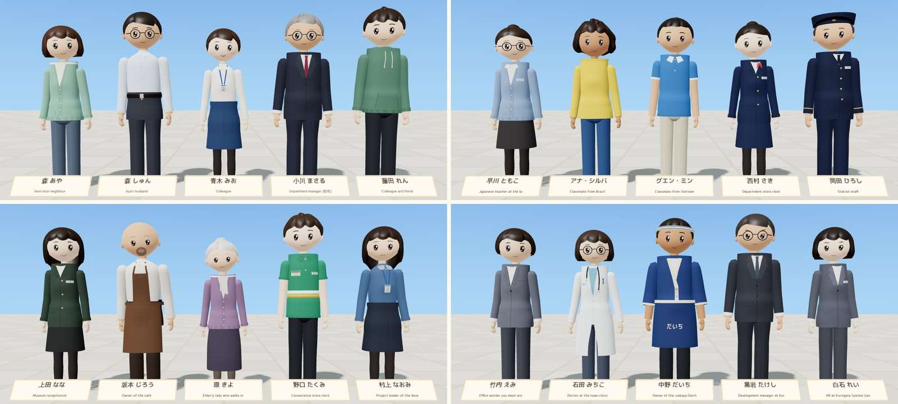

# ことばタウン — Kotoba Town


VR の まちで、日本語を **声に 出して** 練習する アプリです（three.js r186 + WebXR、ビルド不要）。
『みんなの日本語 初級I』第1課〜第10課の 文法に 合わせた 30 の 場面（各課 3 パターン）が あり、
まちの 人（NPC）が 話しかけて きます。あなたが 日本語で 答えると、**Gemini Live** が 聞いて 判定し、
答えの 内容で 会話が 分かれます。台本に ない ことを 言うと、相手が Gemini Live の 声で その場で 返事を します。

- Meta Quest 2 / 3 の ブラウザ（VR）と、PC の ブラウザ（マウス）で 遊べます
- マイクは スタートを 押した ときに オンに なり、会話の あいだ ずっと オンです（相手が 話して いる あいだだけ 自動で 止めます）
- 判定・ふりかえり（評価文）は 英語、会話は 日本語です
- UI は どうぶつの森のような、まるくて やさしい 見た目に しています

## 遊び方

1. `kotoba-town/index.html` を 開く（公開後は https://tomy1031.github.io/lab/kotoba-town/ ）
2. **せってい** で Gemini API キーを 登録する（下の「API キーの 登録」）
3. **VRで はじめる**（Quest）または **PCで はじめる**
4. まちの 広場の 掲示板で 課を えらび、3 つの 場面から 1 つ えらぶ
5. 説明カードを 読んで **はじめる** → 相手が 話しかけて くる
6. カードが **あなたの ばん**（緑の マイク）に なったら、日本語で 答える
7. 答える たびに ★（0〜3）と 直した 文・英語の ヒントが 出ます。さいごに Gemini Live の ふりかえり（英語）が 出ます

困った ときは 声で「もう いちど おねがいします」「わかりません」と 言えば、相手が くり返したり、ゆっくり 言ったり、ヒントを 出したり します。
カードの **ヒント**（1回目＝文の 形、2回目＝答えの 例）、**もういちど**、**スキップ** も 使えます。

| 操作 | PC | Quest |
|---|---|---|
| 見回す | ドラッグ／←→ | 頭を 動かす・右スティックで 30° ずつ 回る |
| えらぶ | クリック | 指す ＋ トリガー（ハンドトラッキングは ピンチ） |
| メニュー | Esc | A／X ボタン |

## API キーの 登録（大事）

**アプリで 会話・判定に 使う キー（あなたの キー）**

1. [Google AI Studio](https://aistudio.google.com/apikey) で Gemini API キーを 作る（無料枠で 使えます）
2. アプリの 最初の 画面で **せってい · Settings** を 押す
3. **Gemini API key** の 欄に 貼り付けて **つながるか テスト** → `✓ OK — gemini-3.8-live` と 出れば OK
4. **ほぞん · Save**

- キーは **その ブラウザの localStorage（`kotoba.geminiKey`）だけ**に 保存され、Google の Gemini Live API（`generativelanguage.googleapis.com`）以外には 送りません。サーバーや GitHub には 置きません
- **Quest で 遊ぶ ときは、Quest の ブラウザで 1 回 登録**して ください（PC と Quest は 別の ブラウザなので 共有されません）。Quest の ブラウザでも キーボードで 貼り付けできます
- キーが ない ときは「オフライン練習」に なります：答えの 例を 声に 出して 読み、カードの ボタンを 押して 進みます（判定は 簡易版）

**作り置きの 声を 作る キー（GitHub Actions 用）**

NPC の 決まった セリフ（557 行）は、[tomy1031/nexmax-academy](https://github.com/tomy1031/nexmax-academy) の GitHub Actions で
Gemini Live に 読ませて 作りました。そこの キーは すでに **nexmax-academy の Settings → Environments → `Preview` の Secret `GEMINI_API_KEY`**
に 登録されて います（教材の 音声づくりと 同じ もの）。新しく 登録する 必要は ありません。

## しくみ

```
lesson JSON（data/lessons/l01〜l10.json）── Fable が ネットで 調べて 書いた 台本（各課 3 場面・分岐つき）
  │
  ├─ 声：nexmax-academy の Actions → Gemini Live で 読み上げ → 文字起こしで 台本と 照合 → mp3（audio/voice/）
  │
  └─ ゲーム（js/）
       Stage   … 場面（js/world/scenes/*.js）・人物（js/people/person.js）・環境音
       Runner  … 台本を 進める。NPC の セリフは 作り置きの 声で 再生
       LiveBrain … 場面ごとに Gemini Live と 1 本 つなぐ（WebSocket）
                   学習者の 声を 16kHz PCM で 流し、話し終わる たびに judge_reply（関数呼び出し）で
                   「どの 分岐か・0〜3 点・直した 文・英語の ヒント」を 返させる
                   台本外の 発言には 相手の 声で 1 文 返事（say: "react"）。さいごに final_report
```

- **判定は Gemini Live**（関数呼び出し `judge_reply` / `final_report`）。プロンプトと 関数の 定義は `js/talk/judge.js`、つなぎ方は `js/talk/live.js`・`js/talk/brain.js`
- モデルは `gemini-3.8-live` → `gemini-3.1-flash-live-preview` → `gemini-2.5-flash-native-audio-preview-12-2025` → `gemini-2.5-flash-live` の 順に ためします（せっていで 固定も できます）
- **本物の API で 確かめました**（nexmax-academy の ワークフロー `Kotoba Town e2e`）
  - self-check：ブラウザ用の コード（`js/talk/*.js`）を Node で 動かし、Live TTS で 作った 学習者の 声を マイクと 同じ 形で 流す。
    自己紹介・名前だけ・「もう いちど おねがいします」・英語・相手への 質問の どれも 正しい 分岐に なり、
    台本外の 質問には 相手が 短く 答えた（「トイレは どこですか」→「トイレは あちらです。」）
  - 通し試験：本物の ブラウザ（Chromium）で アプリを 開き、合成した 学習者の 声を 偽マイクに して 第1課の 会社の 場面を 会話。
    `gemini-3.8-live` が 判定し、「アメリカの かたですか」への「ベトナムから 来ました」を「アメリカ人では ない」の 分岐に 進めた
- 人物は 手続き的に 作った 3D モデル（骨組み＋GPU スキニング。1 人 約 3 ドローコール）。まばたき・目線・口の 動き（音量から）・おじぎ・うなずき・指さし・手わたし などの しぐさ。まちの 人は 15 人で、課を こえて 何度も 出て きます（`js/content/cast.js`）


- 場面の 文法の 位置関係（これ／それ／あれ、ここ／そこ／あそこ）は 小道具の 置き場所（near／npc／far）で そろえて います

## 内容（30 場面）

| 課 | 場面 |
|---|---|
| 1 はじめまして | 会社の 初日・日本語学校の 初授業・カフェで 人ちがい |
| 2 これは なんですか | となりの 森さんに あいさつ・忘れ物（だれの かさ？）・名刺 |
| 3 どこですか・いくらですか | デパートの ワイン売り場・会社の 案内・きっさてんの コーヒー |
| 4 なんじから なんじまで | 美術館に 電話・閉館 20 分前・月曜の 朝 |
| 5 どこへ いきますか | 駅で 電車を たずねる・公園の ベンチで 原さんと・週末の 話 |
| 6 いっしょに たべませんか | ラーメンの さそい・お花見・マスターと 朝の コーヒー |
| 7 おみやげを どうぞ | 森さんの いえ・誕生日の つぎの 日・テストの 朝 |
| 8 どんな まちですか | 晩ごはんの あと・桜の 公園・部長と 話す |
| 9 すきですか、ちょっと…… | コンサートの さそい・日曜の 晩ごはん・どうして 日本語を？ |
| 10 どこに ありますか | 雨の 夜の コンビニ・森さんの いえで 探し物・この 近くに…… |

各課の 調査メモ（出典つき）は `docs/research/lNN.md`、台本の 書き方は `docs/SCENARIO_SPEC.md`、場面の 作り方は `docs/SCENE_BUILDING.md`。

## 開発

```bash
cd kotoba-town
node tests/serve.mjs 8090          # http://127.0.0.1:8090/ （?play=l01a で その場面から、?debug で ログ）
node tools/validate.mjs            # 台本の 検査（30 場面）
node tests/unit.mjs                # 判定・ローマ字・Live の やりとり（にせの Live サーバー）
node tests/smoke.mjs --all         # 全 30 場面を オフライン練習で 最後まで 通す（Playwright）
node tools/shot.mjs <dir> "scene=office&view=spawn"   # 場面の 確認用 スクリーンショット（dev/scene.html）
```

### 声を 作り直す

1. 台本（`data/lessons/*.json`）を 直す → `node tools/validate.mjs`
2. `node tools/voice_manifest.mjs` で `data/voice_manifest.json` を 作り直す
3. それを nexmax-academy の ブランチ `claude/kotoba-town-voices` の `kotoba-town/manifest.json` に コピーして push
   → ワークフロー「Kotoba Town voices (Gemini Live)」が 走り、変わった 行だけ 作り直して 同じ ブランチに コミットします
4. `git -C <nexmax-academy> fetch origin claude/kotoba-town-voices && git -C <nexmax-academy> archive FETCH_HEAD kotoba-town/out | tar -x -C /tmp/kv`
5. `node tools/import_voices.mjs /tmp/kv/kotoba-town/out` で `audio/voice/` に 取り込む

まだ 声が ない 行は、ブラウザの 音声合成（あれば）か、字幕だけで 進みます。

## 注意

- 『みんなの日本語』の 本文・登場人物は 使って いません（文法の 範囲だけを 参考に、場面と 人物は オリジナル）
- Gemini Live の 無料枠には 1 分あたり・1 日あたりの 上限が あります。使いすぎの ときは オフライン練習に 切り替わります
- 声は 生成 AI（Gemini）の 声です
