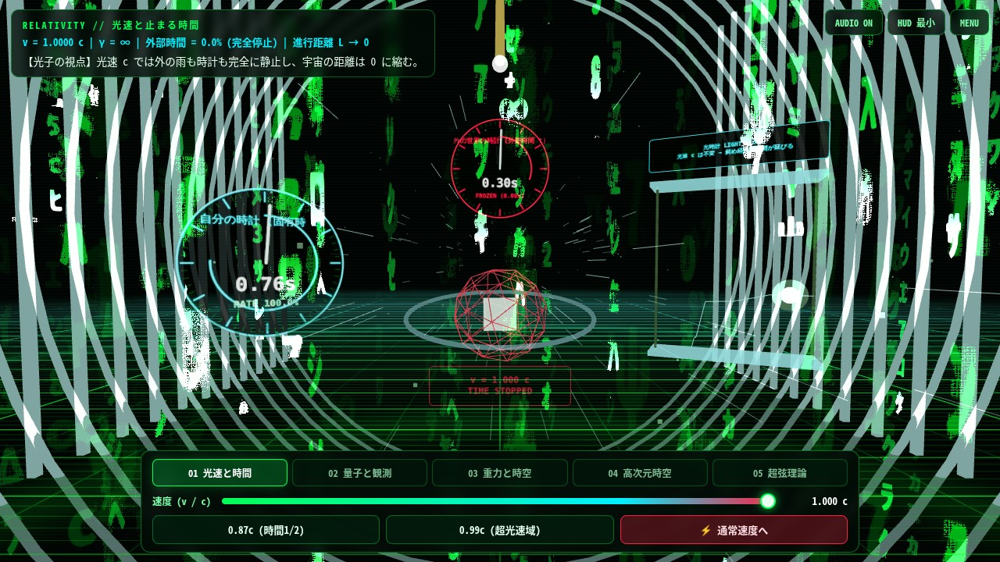

# THE MATRIX : COSMOS — 量子・相対性理論・高次元・超弦理論 体感VR

数式を読むのではなく、**マトリックスの世界観の中で身体感覚として現代物理学を知覚する** Meta Quest 向け WebXR VR 教育アプリです（three.js + WebXR、オフライン対応、PC・スマホのブラウザでも動作）。

周囲 360° に降り注ぐ 3D マトリックス・デジタルレインは単なる背景ではなく、物理シミュレーションと直接連動しています。光速に近づけば雨粒ごと時間が凍りつき、ブラックホールがあれば重力井戸へ曲がり、量子力学では観測によって波の揺らぎが粒子へ収縮します。



## 5つの体感領域（SENSORY REALMS）

| # | 領域 | 体感できる現象 |
|---|---|---|
| 01 | **光速と時間** (`LIGHTSPEED`) | `0c → 0.9999c → 1.000c` へ加速。周囲のデジタルレインと外の時計がスロー化し光速で**完全停止**。自分の固有時との対比、**光時計**の斜め経路による時間の遅れの可視化、ローレンツ長さ収縮、ドップラー青方／赤方偏移。 |
| 02 | **量子と観測** (`QUANTUM`) | 3D 二重スリット実験のリアルタイム波動干渉メッシュと検出スクリーンの干渉縞。**観測レーザー**を向けた瞬間に波が崩壊して2本の粒子帯に変わる現象、手で触れて確定させる**量子もつれ**、位置 `Δx` を絞ると運動量 `Δp` が爆発する**不確定性原理**。 |
| 03 | **重力と時空** (`GRAVITY`) | 質量 `M` に応じて深く沈み込む 3D マトリックス時空格子とシュヴァルツシルト・ブラックホール。コントローラー／クリックで放った光線が時空の曲がりに沿って湾曲する**重力レンズ**、事象の地平線に近づくほど遅れる半径別時計（$\sqrt{1 - r_s/r}$）。 |
| 04 | **高次元時空** (`DIMENSIONS`) | ① **4D ミンコフスキー光円錐**：速度ブーストで「現在の同時刻面」と世界線がハサミのように傾く同時性の相対性。② **4D 超立方体 / 5D 立体**：W軸回転で内側と外側が裏返る高次元投影。③ **10D 余剰次元ズーム**：空間をプランク長 `10⁻³⁵ m` へ拡大し、3次元格子の各点から6次元**カラビ・ヤウ多様体**が開く様子。 |
| 05 | **超弦理論** (`STRINGS`) | 2枚の **Dブレーン膜** の間に張られた5本の巨大な1次元超弦を VR の手で直接弾いて演奏。定常波の振動モード（`n = 1〜5`）で **重力子（閉じた輪が膜から飛び出す）・光子・電子・クォーク** が創発し、2本の弦が滑らかに融合・分裂する **2次元世界面** も観察可能。 |

## 操作方法

### Meta Quest（WebXR / コントローラー & ハンドトラッキング）
- **スティック上下**：各領域の主要物理パラメータ（光速 `v/c`、質量 `M`、次元ズーム、位置の絞り `Δx`、振動モード）を操作
- **トリガー / ピンチ**：光速 1.0c 停止、観測 ON/OFF、重力レンズ光線発射、モード切替、コンソール操作
- **直接タッチ**：超弦を素手で弾く（ハプティクス＋倍音シンセ）、量子もつれ球に触れてスピン確定
- **A / X ボタン**：体感領域を次／前へ切替
- **B / Y ボタン**：腰元のホログラムコンソールを表示／非表示（完全360°没入モード）

### PC・スマホ
- **ドラッグ**：360° 見回す ／ **クリック**：光線発射（重力）・弦を弾く（超弦）
- **1〜5 キー**：5つの領域を切替 ／ **Space**：主要アクション ／ **WASD + Q/E**：空間移動 ／ **H**：HUD 最小化

## ローカル実行・ビルド

```bash
# ローカル配信（ビルド不要・静的ファイルのみ）
python3 -m http.server 8080 -d matrix-cosmos

# オフライン PWA バンドル生成
node matrix-cosmos/tools/bundle.mjs matrix-cosmos/dist
```
