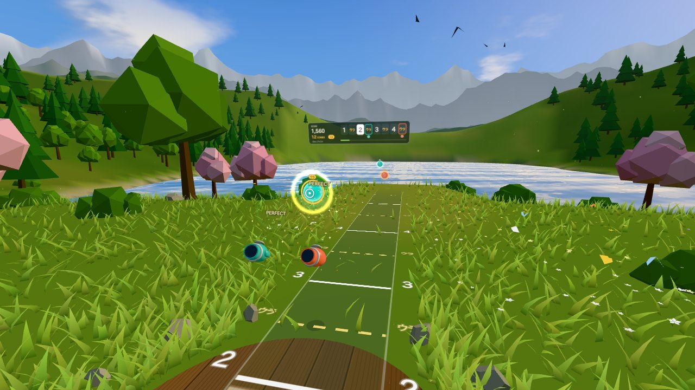

# OFFBEAT GROVE 裏拍ボクササイズ

Meta Quest 3 向けの VR ボクササイズです（three.js + WebXR、ビルド不要、オフライン対応）。
森と湖に囲まれた草原で、音楽に合わせて飛んでくる的をパンチします。ふつうのリズムゲームと違うのは、**裏拍（拍と拍のあいだの「ウラ」）を体で覚える**ことを目的にしている点です。打つたびにずれを測り、終わると表拍・裏拍・16分の裏それぞれについて「早い・遅い・ばらつき」とアドバイスを出します。



## 遊び方（Quest）

1. Quest のブラウザで公開ページ（https://tomy1031.github.io/lab/offbeat-grove/）を開き「VR で遊ぶ」。まわりに 2m×2m ほどの空間をあけて、正面を向いて立ちます
2. 目の前のパネルで曲・リズム・むずかしさ・ガイド音・長さを選び、コントローラーのトリガー（ハンドトラッキングなら指でつまむ）で START
3. 青緑の的は左手、オレンジの的は右手で打ちます。的の数字が着く拍です
4. 一時停止は Meta ボタン（右コントローラーのメタのマーク）。Quest のメニューが開くと止まり、閉じると目の前に一時停止パネルが出ます。再開すると1小節のカウントのあと続きから。パンチ中に指が当たっても止まらないよう、A・B・X・Y ボタンでは止まりません
5. 終わると結果パネル。そのまま「もう一度」か「メニューへ」

| 操作 | コントローラー | ハンドトラッキング |
|---|---|---|
| パンチ | 握ったコントローラーごと的を打ち抜く | 手（こぶし）で打つ |
| メニューの選択 | レーザーを向けてトリガー | 指先を向けて、つまむ |
| 一時停止 | Meta ボタン | Meta のジェスチャー（手のひらを自分に向けてつまむ） |

打つ向きも見ています。矢印のない的はまっすぐ（ストレート）、→ / ← はフック（横から）、↑ はアッパー（下から）。ゆっくり手を置くだけでは「よわい」になります。枝が流れてきたら、ひざを曲げてくぐります（いつも小節の頭、1拍目です）。

## 裏拍トレーニングのしくみ

**見て分かる**
- 的は「色・まん中の印・上の札」で読みます（メニューの横とページに「的の見かた」の図）
  - 色＝どちらの手：青緑は左手、オレンジは右手（グローブと同じ色）
  - まん中の印＝打ち方：◎はまっすぐ、曲がった矢印はフック（横から）、上向きの矢印はアッパー（下から）
  - 上の札＝いつ打つか：「1〜4」はその拍（表拍）、金の「ウラ」は拍と拍のまん中（裏拍）、ピンクの「16ウラ」はもっと細かいウラ
- 外側の光る輪が縮んで、的に重なった瞬間がジャスト。宙に浮かぶ2つの輪が、まっすぐのパンチが当たる場所です
- 最初の3回は、新しい種類の的が来るたびに上に「左フック：左から横に振る」「ウラ＝拍と拍のまん中で打つ」などのヒントが出ます（設定で「いつも」「なし」も選べます）
- 足元のビートレーン：8分音符ごとの線が的と同じ速さで流れてきます。実線が表拍、破線がウラで、線の横にカウントが付きます。破線の上に浮かんでいる的は「ウラ」に着きます
- 頭上のスコアボードに「1 ウラ 2 ウラ 3 ウラ 4 ウラ」。いまの位置が光り、この小節で打つ場所に手の色の印が付きます

**体で覚える**
- 4小節ずつ同じパターンをくり返し（手もパンチの種類も同じ）、次の4小節で変わります。2小節目から体が覚えられる長さです
- 裏拍モードでは枝くぐりが小節の頭に来ます。「体（ひざ）で表拍、拳で裏拍」
- ガイド音（打つ場所のウッドブロック）は、表拍・裏拍・16分で音の高さが違います。「だんだん消える」にすると曲の後半はガイドなしになり、自分のリズムだけで打つ練習になります

**測って教える**
- 打った瞬間のずれをミリ秒で測り、表拍「1 2 3 4」・裏拍「ウラ」・「16ウラ」に分けて、平均（＋は遅い、−は早い）とばらつきと分布を出します
- 例：「裏拍が平均 38ms 早めです。キック（表拍）でひざを軽く曲げ、ひざが伸びるところでパンチすると、拍と拍のまん中に入ります」「表拍と裏拍の平均に 45ms の差。裏拍だけ急いでしまうクセがあるようです」「前回より ばらつきが 9ms 小さくなりました」
- 時刻は「いま耳に届いている音」に合わせています（Web Audio の出力時刻と出力遅延を使用）。Bluetooth イヤホンなどでずれる場合は、設定の「タイミング補正」か「クリックに合わせて測る」で直せます

| リズム | 打つ場所 | ねらい |
|---|---|---|
| 表拍 | 1・2・3・4 | テンポに体をのせる基本 |
| 裏拍 | 「ウラ」 | 拍と拍のまん中を打つ。むずかしいでは16分のつなぎも |
| 表裏ミックス | 表拍の小節と裏拍の小節が入れかわる／表裏の混ざった小節 | 切りかえで迷わない |
| シンコペーション | 3-3-2（トレシージョ）、クラーベ、「16ウラ」 | ずれたリズム |

むずかしさ（やさしい／ふつう／はげしい）で、パターンの密度、フック・アッパー・ボディの割合、判定の幅（ジャスト ±60/45/35ms）、的の速さが変わります。やさしいはどちらの手で打っても OK です。

## 曲

YouTube の1曲を除いて、すべてオリジナルで、Web Audio でその場で生成しています（音源ファイルなし、オフラインでも鳴ります）。ジャンルは「裏拍がどこにいるか」で選びました。

| 曲 | BPM | ジャンル | 聞きどころ |
|---|---|---|---|
| Morning Dew 朝つゆのビート | 90 | ローファイ・ヒップホップ | キックが1と3、スネアが2と4。表拍の練習に |
| River Skank 川辺のスカ | 100 | スカ／ロックステディ | ギターの「チャッ」が全部裏拍。裏拍の入門 |
| Summit Funk 山頂ファンク | 108 | ファンク | 16分で跳ねるベースとクラビネット |
| Canopy House 木もれびハウス | 122 | ディープハウス | 4つ打ちのキックに、オープンハイハットとベースが裏拍 |
| Firefly Breaks ほたるのブレイクビーツ | 134 | ブレイクビーツ | キックがずれて入る上級者向け |
| Summer Night Run 夏夜ラン | 220（110 で打つ） | ギターロック | 速い8ビートを半分で打つ。キック「ドン」が拍、スネア「タン」がウラ。下の YouTube の曲と同じテンポで、オフラインでも遊べる |
| Metronome Trail メトロノームの小道 | 60〜160 | リズムドリル | ドラムだけ。テンポを変えて苦手なリズムを反復 |
| 八月、某、月明かり（ヨルシカ） | 220（110 で打つ） | YouTube・公式 MV | 下の「YouTube の曲」を参照。インターネットが必要 |

各曲はフル（約2分半）とショート（約1分）。イントロ → A → B → ブレイク（枝くぐり）→ C（いちばん盛り上がる）…と進み、盛り上がるほど的が増えます。

## YouTube の曲（ヨルシカ「八月、某、月明かり」）

ヨルシカ公式チャンネル（ヨルシカ / n-buna Official）の MV を YouTube の埋め込みプレーヤーで流し、それに合わせて的が飛んできます。BPM 220 の曲を半分の 110 で打つので、キックの「ドン」が拍、スネアの「タン」がウラ（裏拍）になります。

- **インターネットが必要です。** 動画は YouTube から毎回再生し、端末に保存しません（YouTube の規約上、保存はできません）。オフラインのときは選べても START で理由が出ます。代わりに、同じテンポのオリジナル曲「Summer Night Run 夏夜ラン」がオフラインで遊べます。CD や配信で買った音源ファイルがあれば「じぶんの曲」で読み込むと、オフラインでも遊べます
- **最初に1回「拍あわせ」をします**（VR に入る前のページで）。曲を選ぶと「YouTube の曲」の枠が出るので「拍あわせ」を押し、ドラムが入ったら拍に合わせて16回タップ（スペースキーでも）。ページの中からは YouTube の音を聞けないので、拍の位置はあなたのタップから覚えます。音が耳に届くまでの遅れもいっしょに測れます。覚えた位置はその端末に保存されます
- 「クリック付きで確認」でクリックがドラムと重なるか聞けます。ずれていたら「表と裏を入れかえる」（ドンとタンが逆のとき）、「『1』を1拍ずらす」、「−10ms／+10ms」で直せます
- 再生中は YouTube のプレーヤーを画面の右下に小さく出しています（YouTube のプレーヤーは隠さずに使う決まりのため）。一時停止すると動画も止まり、再開すると1小節前から流れます
- テンポは一定（220）と考えて的を作っています。動画の前後のおしゃべりや無音の部分では、的だけが流れます

## じぶんの曲で遊ぶ

PC・スマホ、または Quest のブラウザ（VR に入る前の画面）で「音楽ファイルをえらぶ」。MP3 などを読み込むと、テンポ（BPM）と拍の位置を自動で見つけて、その曲に合わせた的を作ります。

- 「クリック付きで確認」で、検出した拍にクリックを重ねて聞けます。ずれていたら BPM の ±・×2・÷2、ほかの候補、「表と裏を入れかえる（半拍）」、「『1』を1拍ずらす」、±ms で直せます
- 曲の盛り上がり（音量）に合わせて的の多さが変わります
- 最後に読み込んだ曲は端末の中（IndexedDB）に保存され、次回もオフラインで使えます。ファイルが外に送られることはありません
- テンポが一定の曲（ポップス、ダンス、ドラムがクリックに合わせた曲）が向いています。生演奏でテンポが揺れる曲は、だんだんずれます

## オフライン

公開版（GitHub Pages）は PWA です。一度ページを開くと、ゲームのファイル（three.js も含めて約 1.1MB）がすべて端末にキャッシュされ、以降はネットにつながっていなくても起動して遊べます。メニュー下に「オフラインでも遊べます」と出れば準備完了です。新しい版が出ると「新しいバージョンに更新」ボタンが出ます。

- three.js は `js/vendor/` に同梱（CDN を使わない）、フォントは端末の日本語フォント、音楽は生成なので、外部への通信はありません（YouTube の曲を選んだときだけ、YouTube のプレーヤーを読み込みます）
- WebXR には HTTPS が必要ですが、キャッシュから開いた場合もそのまま VR に入れます

## PC・スマホ

VR がなくても遊べます（リズム練習として）。<kbd>F</kbd>・<kbd>D</kbd>＝左、<kbd>J</kbd>・<kbd>K</kbd>＝右、<kbd>Space</kbd>＝くぐる、<kbd>Esc</kbd>＝一時停止。スマホは画面下のボタン。「オートプレイを見る」で流れを確認できます。

## 設定

タイミング補正（±150ms、クリックに合わせて測る）、音量（音楽・ガイド音・効果音）、座って遊ぶ（枝くぐりなし）、レーンのカウント表示、画質（軽量は草木を減らす）。記録（曲・リズム・むずかしさ・長さごとのベスト）と、直近40回のタイミング履歴は、その端末のブラウザにだけ保存されます。

## 仕組み

| ファイル | 内容 |
|---|---|
| `index.html` | ページ（メニュー、自分の曲、設定、PC 用の操作、一時停止と結果） |
| `js/main.js` | レンダラー、WebXR セッション（`immersive-vr` / `local-floor` / `hand-tracking`、対応すれば 90Hz）、フレームループ、画面の流れ |
| `js/world.js` / `js/sky.js` | 草原・森・湖・4重の山並み（遠いほど青く淡い空気遠近法）・鳥・花粉。空は起動時に一度だけ GPU でテクスチャに描き、湖はその空を映します |
| `js/audio.js` / `js/synth.js` | 音のエンジン（ドラムは起動時に合成、楽器はオシレーター）、リバーブ、ガイド音、効果音、自然の環境音、耳に届く音に合わせた時計 |
| `js/songs.js` / `js/player.js` | 曲（コード進行・メロディ・セクション・ジャンルごとの16ステップのパターン）と再生（生成曲と自分の曲で同じ仕組み） |
| `js/chart.js` | リズムモード別のパターンから譜面を作る（4小節くり返し、手とパンチの割り当て、枝くぐり） |
| `js/game.js` | 1曲ぶんのプレイ：的の動き、グローブの当たり判定（前フレームからの軌跡で判定）、採点、表拍・裏拍別の分析とアドバイス |
| `js/lane.js` / `js/targets.js` / `js/fx.js` | ビートレーン（シェーダー）、的と枝、打ったときのエフェクト |
| `js/gloves.js` | コントローラー・ハンドトラッキングからグローブへ、レーザー、振動、PC 用のパンチ |
| `js/vrui.js` / `js/dom.js` | VR 内のパネル（キャンバス描画）とページの UI |
| `js/beat.js` | 自分の曲のテンポと拍の検出、IndexedDB への保存 |
| `js/youtube.js` | YouTube の曲：プレーヤーの読み込み、動画の時刻をなめらかな時計にする、タップから拍の位置を求める |
| `sw.js` / `manifest.webmanifest` / `tools/bundle.mjs` | オフライン用のサービスワーカー（公開時にファイル一覧を埋め込む）、PWA の設定、公開用の組み立て |

**的の動き**：的は手前ほどゆっくりになります（拍の τ 秒前の距離 = v0·τ + k·τ²）。遠くでは速く見やすく、打つ場所では遅い（ふつう 2.6m/s）ので、±0.15 秒の早い・遅いも腕の届く範囲（約 ±0.4m）に収まり、結果のずれは本当にあなたのずれになります。

## テスト

```bash
cd offbeat-grove
npm install
npm test
```

- `tools/music.mjs` … 全曲を OfflineAudioContext で描き出し、音が出ている・クリップしない・NaN がないことを確認。さらに、その音を「自分の曲」用のテンポ検出にかけて、正しいテンポが見つかる（または候補に出る）こと、拍のはっきりした曲では拍（裏拍ではなく）を見つけることを確認
- `tools/smoke.mjs` … リズムモードごとの譜面（表拍は表拍だけ、裏拍は「ウラ」だけ…、同じ手の連打がない、枝は小節の頭だけ、座りでは枝なし）、オートプレイで1曲最後まで（実際の当たり判定を通して S ランク）、結果と分析、キーボード操作、一時停止と再開
- `tools/xr.mjs` … Meta の WebXR エミュレーター（IWER、Quest 3）で、VR に入る → レーザーとトリガーで START → コントローラーで的を打つ → A・B・X・Y では止まらず、Meta ボタン（Quest のメニュー）で一時停止 → レーザーで再開 → ハンドトラッキング → 結果パネル → メニュー → VR を出る
- `tools/youtube.mjs` … YouTube の曲を、YouTube のプレーヤーの代わり（時刻を 0.25 秒ごとにしか知らせない偽物）で確認：拍あわせ前は START できない → 40ms 遅れてばらつく16回のタップから拍の位置が求まる → 動画の時計に合わせてオートプレイ → 一時停止で動画も止まり、再開で1小節前から → オフラインでは理由を出して始めず、同じテンポの夏夜ランは遊べる
- `tools/offline.mjs` … 公開用に組み立て → 一度開いてキャッシュ → ネットを切り、サーバーも止めて再読み込み → メニューが出てオートプレイで遊べること
- `tools/shots.mjs` / `tools/icons.mjs` … `docs/` の画像とアイコンを作り直す

## 自分で公開する

`npm run build` で `dist/` に公開用一式ができます（サービスワーカーにファイル一覧と版が入ります）。HTTPS で配信できればどこでも動きます。lab のサイトでは `site/build.mjs` がこの組み立てを呼びます。
PC で `npm run serve` したもの（開発版、オフラインキャッシュなし）を Quest から見る場合は、USB 接続して `adb reverse tcp:8080 tcp:8080` を実行し、Quest のブラウザで `http://localhost:8080/` を開きます（localhost は HTTPS でなくても WebXR が使えます）。

---

※ 医療機器ではありません。痛み・めまい・気分の悪さを感じたらすぐに中止してください。まわりの人や物、天井の高さに気をつけて遊んでください。消費カロリーは時間からの目安です。
