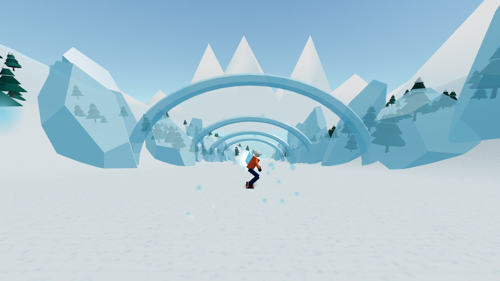
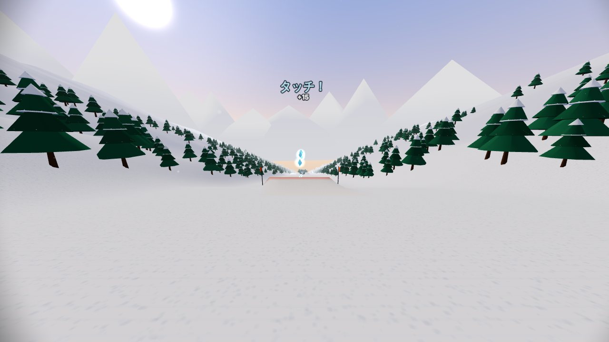

# POWDER LINE — 体で 滑る VR スノーボード

体を **傾けて 曲がり**、**しゃがんで 加速**、**伸び上がって ジャンプ**、空中で **体ごと 回って スピン**。体の 動きと 画面の 動きが 一致する ように、曲がり方・跳び方・回り方を 物理で つないだ アーケード スノーボードです（three.js r170 + WebXR、ビルド不要、**オフライン対応**）。Meta Quest 向けで、PC・スマホの ブラウザでも 遊べます。

斜面を 下り続けながら クリスタルと リングを 集め、キッカーで 技を きめ、分かれ道を えらんで ゴールへ。タイムと 得点で ランク（S・A・B・C）が つき、最速の 自分が ゴーストに なって 一緒に 滑ります。コース・キャラクター・絵・音楽は すべて オリジナルです。



## 遊び方（Meta Quest）

1. Quest の ブラウザで **https://tomy1031.github.io/lab/powder-line/** を 開き「VR で すべる」。まわりに 半径 1 m ほどの 空間を あけます
2. **スノーボードの ように 立ちます**。横向き（レギュラー・グーフィー）でも 正面向きでも かまいません。座って 遊ぶなら 設定の「操作」を「スティック」に
3. 浮かぶ 板で コースを えらび、レーザーで 指して トリガーで「スタート」（A / X でも）
4. **斜面の 下を 見て 少し じっと** すると、立ち位置・身長・向きを 測ります。足もとに 輪が 出ます（輪の 中の 点が あなたの 頭）
5. 3・2・1 で 滑りだします。**B / Y** で ひと休み（はじめから・立ち位置の 合わせ直し・設定）



| したい こと | VR（体で 滑る） | VR（スティック・座って） | PC・スマホ |
|---|---|---|---|
| 曲がる | 体ごと 左右へ 傾く。傾けるほど 鋭く | 左スティック 左右 | ← →（A D）、Shift で 深く・画面の ◀ ▶ |
| 加速 | ひざを 曲げて 低く（タック） | 左スティック 前 | ↑（W） |
| 減速 | 体を 山側（後ろ）へ 引く | 左スティック 後ろ | ↓（S） |
| ジャンプ | しゃがんで → すばやく 伸び上がる（足は 床から 離さなくて よい）・トリガー | トリガー（押して ためて はなす） | Space（押して ためて はなす） |
| スピン | 空中で 体ごと 回る（板が 同じ だけ 回る） | 空中で 右スティック 左右 | 空中で ← → |
| グラブ | 空中で 手を 足もとへ 下ろして グリップ | 空中で グリップ | 空中で Z / X |
| ソフト着地 | 着地の 瞬間に ひざを 曲げる | トリガーを 押しておく | 着地の 瞬間に Space か ↑ |
| クリスタル | 体で ふれる。**手で さわると 1.5 倍** | 体で ふれる | 体で ふれる |

**得点**：クリスタル（青 10・緑 30・金 100）、リング 50（くぐると 加速）、エア（滞空 0.6 秒から）、スピン（180：100 … 1080：1000）、グラブ（100＋長く つかむほど）、スピン＋グラブは ×1.2、ソフト着地 ＋20%、基準タイムより 速ければ 1 秒 30 点。着地が 斜め（ぐらつき）は 半分、90° ずれると 転倒。

## コース

| コース | 内容 |
|---|---|
| れんしゅうゲレンデ | 看板に そって 順に 練習：傾いて 曲がる → しゃがんで 加速 → 丸太を オーリーで 越える → キッカーと グラブ → 大きい キッカーで スピン → ブレーキと ソフト着地 |
| ゆきうさぎの丘（初級） | 朝の 広い 斜面。S字、ローラー、分かれ道（左は クリスタルの 列、右は 小さい キッカーと リング）、3 つの キッカー、リングの スラローム |
| こおりの谷（中級） | 氷の 壁と アーチの トンネル、氷柱の スラローム、崖の ドロップ（分かれ道の 左）、3 本に 分かれる 道（真ん中は 氷柱の 間の 金）、コブ |
| オーロラの峰（上級） | 夜。オーロラと 星、道しるべの 灯り。林の 中の スラローム、コブ、崖、キッカーの 連続、最後に 大きな キッカー |

## 設定

| 設定 | えらべる もの |
|---|---|
| 視点の 向き | **斜面に 固定**（おすすめ・景色が 回らない）／進行方向に 回る（本物の ように 板と 一緒に 回る） |
| 視野しぼり | なし／弱／強（強く 曲がる・速い ときに 視野の 端を 暗く） |
| ジャンプ | 体＋トリガー／体だけ／トリガーだけ |
| 操作 | 体で 滑る／スティック（座って） |
| スタンス | レギュラー（左足前）／グーフィー（右足前）／正面向き（技の 名前と FS・BS に 使う） |
| 曲がりやすさ | ふつう／大きめ／小さめ |
| そのほか | 音楽・効果音・ゴースト・足もとの 輪 |

## 体と 画面を 一致させる しくみ

くわしくは [docs/DESIGN.md](docs/DESIGN.md)。

- **傾き → 求心加速度 a = g·tan(3φ)**：本物の ライダーは 遠心力と 重力の 合力が 体の 軸に 沿う ように 傾く（tan 傾き ＝ a/g）。同じ 傾きは どの 速さでも 同じ 横 G で、遅いと 小回り・速いと 大回り
- **伸び上がる 速さ ＝ ジャンプの 強さ**。伸び上がった その フレームで 板が 雪を 離れる
- **空中で 回った 角度 ＝ 板の 回転**（1:1）
- **ゲームは 頭を 動かさない**。測った 立ち位置（足）が いつも ライダーの 位置に 乗る ように 足もとの 世界を 運ぶ。地平線は 傾けず・揺らさず、転んだら 白く フェード
- 標準では **景色を 回さない**（コースは いつも 前へ 下り、左右に うねる）。振動・風の 音・足もとの 板と 輪で、速さと エッジの 感覚を そろえる

## ファイル

| ファイル | 内容 |
|---|---|
| `js/course.js` | 雪面の 式（縦断面・土手・キッカー・島・ローラー・コブ・ドロップ）、木と 障害物、クリスタルの 放物線 |
| `js/courses.js` | 4 つの コースと 空の 色 |
| `js/physics.js` | ライダーの 物理（エッジ・摩擦・空気抵抗・離陸と 着地・スピン・衝突）と ルール（得点・ランク） |
| `js/body.js` | ヘッドセットと コントローラー → 傾き・しゃがみ・ブレーキ・ジャンプ・吸収・スピン・グラブ。スティック操作 |
| `js/world.js` | 空・遠くの 山・オーロラ・雪面・森・氷・クリスタル・リング・看板・降る 雪・雪煙・影 |
| `js/rider.js` | 板と、PC・ゴースト用の オリジナルの ライダー |
| `js/hud.js` | VR の 案内板（レーザー）・手首の 時計・浮かぶ 文字・足もとの 輪・視野しぼり |
| `js/input.js` | キー・ゲームパッド・タッチ、Quest の コントローラー（レーザー・ボタン・振動） |
| `js/audio.js` | 音は すべて Web Audio で 合成（風・エッジ・着地・クリスタル・コースごとの BGM） |
| `js/bot.js` | 自動で 滑る ライダー（タイトル画面の デモと テスト用） |
| `js/main.js` | 描画・WebXR・流れ（メニュー → 立ち位置の 測定 → 3・2・1 → 滑る → 結果） |
| `sw.js` | オフライン用の Service Worker（公開時に `tools/bundle.mjs` が 版と ファイル一覧を 書き込む） |

## 開発

```bash
cd powder-line
npm i                  # テスト用（iwer：Meta の WebXR エミュレーター）
npm run serve          # http://127.0.0.1:8080/
npm test               # 物理と 体 → PC → VR（エミュレーター）→ オフライン
```

| テスト | 内容 |
|---|---|
| `tools/sim.mjs` | 終端速度（立つ・しゃがむ）、傾き → 求心加速度の 式（2 つの 速さ）、左右・ブレーキ、キッカーと オーリー（キッカーの 先で 高く）、360・540（スイッチ着地）・90° で 転倒、木に ぶつかって 再スタート、体の 読み取り（傾きの 角度・しゃがみ・ゆっくり 立っても 跳ばない・速く 伸びると 1 回 跳ぶ・吸収・400° の スピン・グラブ）、自動ライダーが 全 コースを 完走 |
| `tools/smoke.mjs` | PC：デモ、コース選択、設定の 保存、キーで 曲がる・跳ぶ・キッカーで 360 と グラブ、ひと休み、ゴールと 結果、ベストと ゴースト、スマホの タッチボタン |
| `tools/xr.mjs` | Meta Quest 3 の エミュレーター：VR に 入る → レーザーで スタート → 立ち位置の 測定 → 頭を 15 cm 右／左 → 曲がる、しゃがむ → タック、しゃがんで 速く 伸びる → オーリー、空中で 頭を 360° 回す → 360、手を 下ろして グリップ → グラブ、B で ひと休み、ゴール → 結果、「進行方向に 回る」視点、スティック操作、VR を 終わる |
| `tools/offline.mjs` | 公開用に 組み立て、一度 開いたあと ネットも サーバーも 止めて 再読み込み、全 コースが 描けて 滑りだせる こと |

`tools/icons.mjs` で アイコン、`tools/shots.mjs` で `docs/preview.jpg` と `docs/vr-view.jpg` を 作ります。

本物の 雪山での 安全や 技術の 指導を する ものでは ありません。VR で 体を 大きく 動かす ので、まわりに 物や 人が ない ことを 確かめ、気分が 悪く なったら すぐ 休んで ください。
