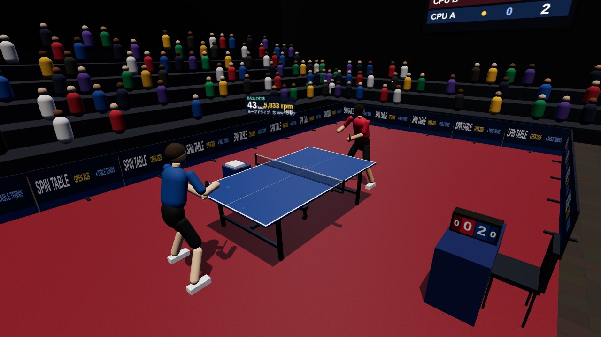

# SPIN TABLE — リアル VR 卓球

Meta Quest 2 / 3 / 3S で、本物のように卓球をする WebXR ゲームです（three.js r186 + WebXR、ビルド不要、オフライン対応）。
コントローラーがそのままシェークハンドのラケットになり、**振ったとおりに当たります**。ボールは空気抵抗・回転（マグヌス効果）・
台とラバーの摩擦まで **1000 分の 1 秒ごと** に計算し、ラケットの面の角度・スイングの向きと速さ・当たった場所（芯・先・ふち）で
打球の速さと回転が決まります。打った瞬間はコントローラーの振動・音・閃光で手応えを返し、速さ（km/h）と回転数（rpm）を表示します。



## 遊び方（Quest）

1. Quest のブラウザで **https://tomy1031.github.io/lab/spin-table/** を開く（WebXR は HTTPS が必要です）
2. メニューでモード（試合・ラリー練習・球出しマシン・サーブ練習）を選び、**VR をはじめる**
3. 周りを片づけ、ラケットを振っても何にも当たらないことを確かめる（**遊ぶ広さの目安：2 m × 2 m**）
4. 利き手のコントローラーがラケット。**手のひらの側がフォア面**（初期値は赤）、手の甲の側がバック面（黒）
5. サーブは、反対の手の上にのったボールを、**トリガーを押して離して**トス（A / X で自動トス）。落ちてくるところを打ちます

台は現実の床から 76 cm の高さに出ます（ガーディアンの床の設定がずれているときは「床の高さの補正」）。
PC では **PC で遊ぶ**（体の移動とタイミングは自動、打ち方と狙う所を選ぶ）。**デモを見る**（`?demo`）は CPU どうしの試合、
`?demo&cam=tv` は会場の角からの中継カメラです。

## 操作

| 操作 | VR（Quest） | PC |
|---|---|---|
| 打つ | ラケット（利き手）を実際に振る | 自動。クリック：ドライブ、右クリック：ツッツキ、L：ループ、Space：スマッシュ、B：ブロック、A：おまかせ。マウスの位置が狙う所 |
| トス | 反対の手のトリガー（またはグリップ）を押して離す。A / X で自動トス | 自動 |
| ラケットの角度 | ラケットを持つ手のスティック：上下で先の向き、左右で面のひねり（1° ずつ） | メニューの「ラケット」 |
| 移動 | 実際に動く。反対の手のスティックで台に沿って移動もできる | 自動 |
| メニュー | B / Y（ゲームは止まる）。レーザーで指してトリガー | M / Esc、右上の「メニュー」 |
| 位置のリセット | スティックを押し込んで 1 秒（いま向いている方がネット） | — |

## モード

- **試合**：CPU（5 段階）と 11 点制のゲーム（1・3・5・7 ゲームマッチ）。サーブは 2 本交代、10-10 からは 1 本交代、2 点差で勝ち。
  ゲームごとに最初のサーバーが交代。レット、サーブのフォルト、ツーバウンド、ボレー（オブストラクション）、エッジ（台の上のふちは有効・側面は無効）、
  2 度打ちを判定し、審判がスコアを読み上げます（音声は英語、表示は日本語）
- **ラリー練習**：CPU が打ちやすい上回転をフォアとバックへ交互に返します。ラリーの回数と最長を表示
- **球出しマシン**：相手側の台の上のマシンが、同じ間隔で球を出し続けます（上回転・下回転・横回転・ナックル・ミックス、速さ、コース、間隔）。
  入った数と連続を表示
- **サーブ練習**：サーブの反則の判定（トス 16 cm 以上・落ちてくるところを打つ・エンドラインの後ろ・台より上）と、
  サーブの速さ・回転・落ちた所を表示

## 打つときの手応え

| 手応え | しくみ |
|---|---|
| **振動** | 強く当たるほど強く。芯（スイートスポット）なら短く「コン」、芯を外すほど 2 段目の「ビーン」が長く、ふち（エッジ）は鋭い「カッ」と余韻 |
| **音** | すべて合成。ラバーの「ポク」は強く打つほど低く太く（スポンジが沈む）、芯を外すと板の低いうなりが混ざる。粒高は鈍い音、エッジは木の高い音。台の「カツン」、ネット、床の連続バウンド、フェンス。打った場所・弾んだ場所から聞こえる（HRTF）、会場の残響つき |
| **見た目** | 当たった所に閃光、ボールが一瞬つぶれる、芯を外すとラケットが震える。ボールのロゴは本当の回転で回り、目で追えない速さになると回転軸のまわりの帯に見える（回転軸が読める）。台に落ちた所に跡 |
| **数字** | 打つたびに、速さ（km/h）・回転数（rpm）・回転の種類（上・下・横）・打ち方（ドライブ、ツッツキ、スマッシュ…）・芯からのずれ（芯 92% など）・フォア面かバック面か |

## リアルにするための計算

- **台・ネット**：ITTF の寸法。台 2.74 × 1.525 m・高さ 76 cm・天板 25 mm、2 cm の白線と 3 mm のセンターライン。ネット 15.25 cm、
  サポートは台の外 15.25 cm。プレーする場所は 14 × 7 m（高さ 75 cm のフェンス）
- **ボール**：40 mm・2.7 g の中空の球（慣性モーメント 0.66 mr²）。重力＋空気抵抗（C_D 0.47：落下の終端速度 8.6 m/s、実測 8〜9 m/s）＋
  マグヌス揚力（C_L = S / (1 + 2S)、S = rω / v）＋空気による回転の減衰。1 kHz で計算し、1 回に 8 mm より動かないようさらに分割
- **台のバウンド**：反発係数は当たる速さで下がる（30 cm から落とすと 23 cm 弾む＝ITTF の基準）。摩擦 0.25 で、すべるか転がりに変わるかを計算し、
  回転も変わる。上回転は前に伸び、下回転は止まる。台の上のふちに当たる「エッジ」は有効、側面は無効
- **ネット**：白帯（コード）は丸い縁として跳ね返り（ネットインもある）、網に当たると勢いを失って打った側に落ちる。サポートにも当たる
- **ラケットとの当たり**：ラケットの姿勢は 72〜90 Hz で来るので、前のフレームと今のフレームの間を補間し、ボールとの距離を
  1 ms ごとに **連続的に** 調べます（ヘッドは 1 フレームで 30 cm 以上動くため。120 Hz・28 m/s の振りでも素通りしないことをテスト）。
  当たった場所のラケットの速度（回転も含む）と、ラバーの面の法線から、法線方向は反発係数、接線方向はラバーの摩擦（裏ソフト 1.0）と
  **接線方向の反発**（トップシートが元に戻る力。裏ソフト 0.38）で計算し、回転がかかります
  - 例：静止したラケットに 15 m/s の球を当てると約 11 m/s で返る。16 m/s で下から上にこすると 6000〜9000 rpm の上回転
  - 芯を外すと：反発が下がる（先端は遅い）、手の中でラケットがねじれて面が当たった側へ向く（方向がずれる）、手に持ったラケットの実効質量が小さくなる
  - ラバー：裏ソフト・粘着・表ソフト・粒高・アンチ。粒高はほとんど引っかからないので、**相手の下回転が上回転になって返る**
  - ラケットの形：シェークハンド（ヘッド 150 × 157 mm、全長 257 mm、板厚 5.8 mm、ラバー 4.0 mm × 2）。当たり判定と見た目は同じ輪郭から作っています
- **CPU**：ボールの行き先を予測し、反応時間のあと人と同じ上限（最高速度・加速）で走り、間に合う打点を選びます。打ち方（ドライブ・ループ・
  ツッツキ・フリック・ブロック・スマッシュ・サーブ 5 種）と狙いを決め、**ラケットの面と振りを逆算して物理のとおりに打ちます**。
  回転を読み違えるとネットやオーバーになり（読み違いはレベルで変わる）、ラケット角度のぶれも加わります。逆算は Web Worker で行い、VR のフレームを落としません
  - レベル 1〜5：最高速度 2.2〜3.8 m/s、反応 0.34〜0.17 秒、回転の読み違い ±22%〜±4%。CPU どうしの試合で 1 点あたり 2.6〜7.6 打、最速 60〜100 km/h

## 初期値とその理由

| 項目 | 初期値 | 理由 |
|---|---|---|
| ラケットの角度（上下） | 30° | コントローラーの人さし指の向きに対して、ラケットの先が少し上を向く（手首を自然にしたシェークハンド）。合わなければスティックで |
| フォア / バックのラバー | 裏ソフト / 裏ソフト | いちばん多い組み合わせ |
| 板 | OFF | 攻撃用の標準的な弾み |
| サーブの反則 | 判定する | 本物と同じ。練習では「表示だけ」も |
| トスのアシスト | オン（30 cm） | 手のひらからまっすぐ真上へ。オフにすると手の動きのまま |
| 打球アシスト | 0 | 物理のまま（本物と同じ）。入りにくいときは少しずつ上げる |
| 相手の強さ | 3（中級） | ラリーが続き、甘い球は打ち返される |

## テスト

```sh
cd spin-table
npm install            # playwright・iwer・three（テスト用。ゲームは js/vendor の three.js を使う）
npm test               # すべて
node tests/unit.mjs    # 物理（終端速度・ITTF のバウンド・回転・ネット・エッジ）・ラバー・ラケットの形・逆算・ルールとスコア（48 項目）
node tests/paddle.mjs  # VR のラケット：72/90/120 Hz で素通りしない、速さ・面の角度・芯・先・ふち・ねじれ
node tests/sim.mjs     # CPU どうしの試合（レベル 1・3・5）：スコアが正しい、ラリーの長さ・速さ・回転が卓球らしい
node tests/smoke.mjs   # ブラウザ：デモ、PC の試合、球出しマシン、メニューと保存
node tests/xr.mjs      # Meta のエミュレーター（IWER、Quest 3）：ラケットで返球・振動・表示、トスとサーブ、VR メニュー、角度、位置リセット
```

`node tests/serve.mjs 8080` で http://127.0.0.1:8080/ に開けます。URL の `?set=mode:machine,level:5` で設定を、`?seed=N` で CPU の判断を固定できます。
`dev/paddle.html` はラケットのモデルの確認用、`node tools/preview.mjs` はサイト用の画像、`node tools/bundle.mjs` は配信用のフォルダ（オフライン用の sw.js 入り）を作ります。

## ファイル

| ファイル | 内容 |
|---|---|
| `js/physics.js` | ボールの飛行・台（エッジ・側面）・ネット・床・フェンス・接触の力積、ラバーの反発と摩擦（three.js なし） |
| `js/paddle.js` | ラケットの輪郭と厚み、フレーム間を連続的に調べる当たり判定、芯・ふち・ねじれ |
| `js/paddlemesh.js` | ラケットのモデル（板・スポンジ・トップシート・粒・エッジテープ・FL グリップ・ロゴ） |
| `js/shot.js` | 狙った所に落とす打ち出しの逆算、サーブの逆算、ラケットの面と振りの逆算 |
| `js/planner.js` `js/planworker.js` | CPU・マシンの判断（予測・打点・打ち方・狙い・読み違い・ぶれ）、Web Worker |
| `js/ai.js` | CPU の動き（反応・走る・届くか）と打球 |
| `js/rules.js` | 1 ポイントの判定（サーブ・レット・ツーバウンド・オブストラクション・2 度打ち）とスコア |
| `js/sim.js` | 描画なしのゲーム進行（試合・ラリー練習・マシン・サーブ練習・デモ） |
| `js/game.js` | ブラウザでの進行：ラケット・トス・振動・音・表示・CPU |
| `js/world.js` `ballview.js` `avatar.js` `hud.js` `audio.js` | 会場、ボール（回転の見え方・影・跡）、CPU の人、表示、音（すべて合成） |
| `js/config.js` `settings.js` `menu.js` `vrmenu.js` `input.js` `main.js` | 設定と初期値、保存、PC と VR のメニュー、入力と振動、起動 |

## 注意

- 実機（Quest）での確認は、Meta のエミュレーター（IWER）と PC のブラウザでのテストまでです。ラケットの握りの角度はコントローラーの持ち方で
  感じ方が変わるので、ラケットを持つ手のスティックか「ラケット」タブで合わせてください
- 審判の音声はブラウザの音声合成（英語）です。声がない端末では表示だけになります
- ラバーやボールのロゴ・名前（VORTEX、SPIN 40+ など）は架空のものです
