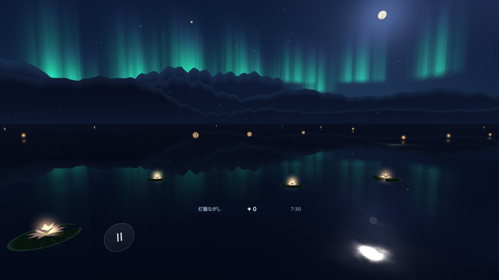

# ほしあかりの湖 — Starlight Lake

Meta Quest 2 / 3 で遊べる、論文にもとづく視覚トレーニングゲーム（three.js + WebXR）。

夕暮れから夜明けまで、ひと晩の湖の旅をします。灯籠をはじき返し、光の精をつかまえ、星座を結ぶ。そのひとつひとつが、研究で効果の報告された訓練法そのものになっています。夜が明けたら今日のおしまい。続けた夜の数だけ、湖に蓮が咲きます。



- **コントローラーでもハンドトラッキングでも**遊べます（つまむ＝選ぶ、つまんで動かす＝はじく）
- インストール不要：Quest のブラウザでページを開いて「VRで旅する」を押すだけ
- 記録はブラウザ内（localStorage）だけに保存されます。サーバーには何も送りません

## 章の構成

| 章 | 鍛えるもの | 下敷きにした研究 |
|---|---|---|
| 静かな水面 | 呼吸に合わせた遠近の目の運動、遠方凝視、まばたき | 20-20-20 ルール、VRでのまばたき減少 |
| 灯籠ながし | 遠近のピント運動（近づく灯籠のランドルト環を読んで押し返す） | 関西学院大学 河盛・井村 2025（Quest 2、6週間で logMAR 0.057→−0.186） |
| 光の精 | コントラスト感度（縞の検出）。乱視で苦手な向きを自動で重点化 | Tan & Fong 2008、Yan 2015、Deveau 2014（ULTIMEyes）、Polat 2004 |
| 星の門 | 側方マスキング＋瞬間提示（40代の処理速度） | Polat 2004、Polat 2012 |
| 浮かぶ星珠 | 立体視（両眼視差だけを手がかりに） | Vedamurthy 2016、Žiak 2017 |
| 流れ星 | 周辺視・反応速度 | Li 2009（アクションゲーム） |

論文ごとの結果・限界・推奨の使い方は **[docs/research.md](docs/research.md)**（[サイト上で読む](https://tomy1031.github.io/lab/starlight-lake/docs/research.html)）にまとめています。度数（近視・乱視そのもの）はトレーニングでは変わらないこと、伸びるのは脳の処理とピントの緊張の分であることも含めて書いています。

## 3つのモード

| モード | どこで | 向いていること |
|---|---|---|
| **VRで旅する** | Meta Quest 2 / 3 のブラウザ | 全章。没入感、遠近の運動、立体視、周辺視 |
| **遠見スクリーン** | PC・TV から 2.5〜4m、**裸眼** | 細かい縞（視力の限界付近）と、実生活のぼけの下での練習。視力チェック（ランドルト環） |
| **この画面で試す** | PC・スマホ | マウスで操作する体験版 |

VRの画素の細かさ（1度あたり約20〜25画素）では、視力1.0の細かさ（30 cpd）は描けません。またレンズのピントは約1.3〜1.5mに固定されています。そのため、近視の視力そのものを狙う練習は遠見スクリーンが担当します（詳しくは research.md の4章）。

## Quest で開く

**Quest のブラウザで https://tomy1031.github.io/lab/starlight-lake/ を開き、「VRで旅する」を押します。**

このページは lab サイト（[`site/build.mjs`](https://github.com/tomy1031/lab/blob/claude/yokohama-roll/site/build.mjs) が各ブランチから組み立て、`gh-pages` ブランチから配信）の一部です。ほかの場所で動かす場合、WebXR は **https** か **localhost** のページでしか動かないので、次のどちらかで開いてください。

**手元のPCから USB で**
PCでこのフォルダを配信し、Quest を USB でつないでポートを転送します（Quest は開発者モードが必要）。

```bash
cd starlight-lake
```

```bash
python3 -m http.server 8080
```

```bash
adb reverse tcp:8080 tcp:8080
```

Quest のブラウザで `http://localhost:8080/` を開きます。

**任意の静的ホスティング**
Netlify・Cloudflare Pages などに `starlight-lake/` フォルダをそのまま置きます。ビルドの手順はありません。

## 操作

| | コントローラー | ハンドトラッキング | PC（マウス・キーボード） |
|---|---|---|---|
| 選ぶ・触れる | トリガー | 親指と人さし指でつまむ | クリック |
| 灯籠をはじく | トリガーを引いたまま動かす／スティックを倒す | つまんだまま動かす | ドラッグ／矢印キー |
| 星の門で左右を選ぶ | 門を指してトリガー／スティック左右 | 門を指してつまむ | クリック／← → |
| 一時停止 | B / Y ボタン、または左下の「Ⅱ」 | 左下の「Ⅱ」をつまむ | Esc |
| 見回す | 頭を動かす | 頭を動かす | 右ドラッグ |

## 設計の要点

- **適応的難易度：** 全課題が 3-down-1-up 階段法で、正答率約80%に収束します。学習が起きる「ぎりぎり見える」強さで、遊びとしても飽きにくい難しさです。
- **乱視への対応：** 光の精と星の門は、空間周波数×4方位ごとに閾値を持ちます。苦手な向きほど多く出題します。
- **正確な刺激：** ガボールのコントラストは線形輝度で計算してから sRGB に変換し、時間ディザで8bitより淡いコントラストも出します。縞の細かさは、その機器の描画バッファの画素密度（1度あたりの画素数）を実測して決めます。
- **両眼バランスモード（弱視向けオプション）：** three.js の目別レイヤーで、課題の光を弱いほうの目だけに描き、よく見える目のコントラストを下げます。
- **飽きない仕掛け：** 五音音階で上がっていくコンボ音、空間音響、夜空に残る自分の星座、蓮の花。そして夕暮れから夜明けへの時間の流れ。

## ファイル構成

```
starlight-lake/
├─ index.html            タイトル画面・設定・記録・遠見スクリーンの準備・起動
├─ docs/research.md      研究ノート（論文、限界、推奨プラン）。research.html はその表示用ページ
└─ src/
   ├─ main.js            アプリ本体（WebXR、視野と画素密度、両眼分離、メニュー）
   ├─ session.js         ひと晩の進行、スコア、HUD、字幕、結果画面
   ├─ input.js           コントローラー・手・マウスの統一ポインタ、はじき判定
   ├─ stimuli.js         ガボール、フランカー三つ組、ランドルト環の灯籠、ランダムドット珠
   ├─ staircase.js       階段法と（周波数×方位）セルの重み付き出題
   ├─ audio.js           環境音、空間音響の鐘、呼吸ガイド（すべて合成）
   ├─ ui.js / fx.js      VR内パネル、光の粒・文字のエフェクト
   ├─ screen.js          画面の大きさの補正（カード法）と視力チェック
   ├─ world/             空・オーロラ・山・湖・ホタル・灯籠・蓮・星座
   └─ games/             各章（lantern, spirits, gates, depth, comets, rest）
```

three.js r180 を CDN（jsDelivr）から importmap で読み込みます。ビルドの手順はありません。

## 開発用

- `index.html?emulate=quest3`（または `quest2`）で、Meta の WebXR エミュレーター（IWER）を読み込み、ヘッドセットなしで VR セッションを試せます。
- コンソールで `__app`（アプリ本体）、`__xrDevice`（エミュレーター）を操作できます。

## 大切なこと

医療機器ではありません。近視・乱視の度数は変わりません。効果には個人差があります。急な見えにくさや目の痛みがあるときは眼科へ。運転のときは必要な眼鏡を。VRは1回15〜25分を目安に、疲れたら休んでください。
