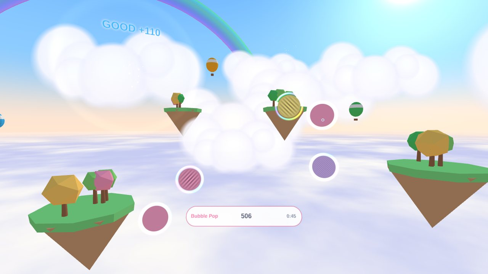

# EYE GYM

**遊ぶことが主役**の「見る力の脳トレ」です。Meta Quest 2 / 3（コントローラーでも、指でつついても）と PC で遊べます。じっくり型の [Starlight Lake](../) の姉妹版です。

- 公開ページ：https://tomy1031.github.io/lab/starlight-lake/arcade/
- 1回1分のミニゲームを、毎日3つ（**きょうのトレーニング**）。好きなものを何度でも遊べる **フリープレイ**
- スコア、S〜D のランク、自己ベスト（NEW RECORD!）
- ゲームごとの **レベル（1〜50）**：難しさの自動調整の値から決まるので、目が実際にうまくなったときだけ上がる
- 5つの力のレーダー（**EYE POWER**）、遊ぶほど上がる **EYE LEVEL** と称号、連続日数とスタンプ
- 明るい空のステージ（雲の海、浮島、熱気球、虹）、軽快なBGM、正解するほど高くなる効果音

## 5つのゲーム

| ゲーム | 鍛えるもの | 遊び方 | 自動で難しくなるもの |
|---|---|---|---|
| Bubble Pop | コントラスト感度 | 手の届く距離に浮かぶシャボン玉のうち、しま模様のものだけを指でつつく（つまむ・クリックでも可） | 縞の淡さ（空間周波数×方位ごと） |
| Ring Rush | 遠近のピント | 30m 先から飛んでくるリングの切れ目の方向へ、はじき返す。遠くで返すほど高得点 | リングの大きさ、速さ |
| Flash Count | 瞬間視・処理速度 | 一瞬だけ光る星の数を当てる | 表示時間、星の数 |
| Depth Order | 立体視（VRのみ） | 手前のボールから順にタッチ | 奥行きの差（秒角） |
| Side Catch | 周辺視・注意 | まん中の目を見たまま、まわりに出る星をつかまえる。目が赤いときは触らない | 星が出ている時間 |

それぞれの下敷きにした研究（Polat、Deveau、関学2025、Vedamurthy、Li など）は [研究ノート](../docs/research.md) にあります。

## オフラインで遊ぶ

一度ネットにつないだ状態でこのページを開き、「VRであそぶ」の下が **「✓ オフライン対応」** になれば準備完了です。以後はネットがなくても、同じURL（ブックマーク・履歴）を開けば VR で遊べます。くわしくは [Starlight Lake の README](../README.md#オフラインで遊ぶ) を見てください。

## つくり

`src/app.js`（進行）、`src/games/`（5ゲーム）、`src/screens.js`（メニュー・結果・記録）、`src/progress.js`（レベル・ランク・デイリー・記録）、`src/world.js`（空のステージ）、`src/sound.js`（BGM と効果音、すべて合成）、`src/visuals.js`（シャボン玉・リング・ボール・星・目のキャラ）。入力・UI・効果・難易度調整は Starlight Lake の `src/` を共有しています。記録はブラウザ内（localStorage）だけに保存されます。

`index.html?emulate=quest3` で、ヘッドセットなしに VR モードを試せます。

医療機器ではありません。近視・乱視の度数は変わりません。VR は 1 回 15〜25 分を目安に。
